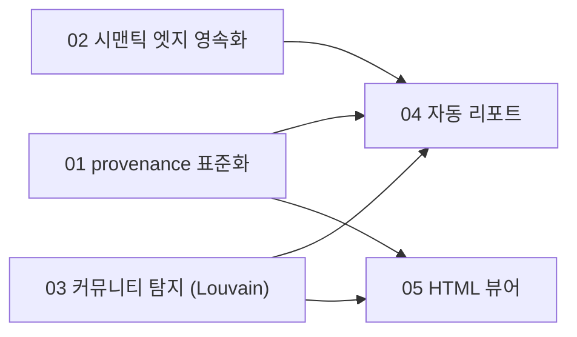

# 마스터 플랜: Graphify 기능 5종 이식

**대상 repo**: `D:\Fork\codegraph` (branch: main)
**작성일**: 2026-07-24
**입력 문서**: [docs/output/2026-07-24-graphify-vs-codegraph.md](../../../docs/output/2026-07-24-graphify-vs-codegraph.md), [05번 라이브러리 3안 비교(2026-07-27)](../../../docs/output/2026-07-27-viewer-library-tradeoff.md)
**참고 소스**: GitHub `Graphify-Labs/graphify`(v8 브랜치, 정적 조사) + 로컬 설치 `graphifyy` v0.9.25(`C:\Users\JANGHYEONGTAEK\AppData\Roaming\uv\tools\graphifyy\Lib\site-packages\graphify\`, 사용자 승인 하 소스 직독)
**상태**: PLAN 완료. EXECUTE는 사용자의 별도 승인 후 진행(RULE-7: 소스 코드 쓰기 전 승인).

## 0. 범위

이식 대상 5개 기능:

1. 자동 생성 내러티브 리포트 (GRAPH_REPORT.md 상당)
2. 커뮤니티/클러스터 탐지 (Leiden)
3. 신뢰도(confidence) 태깅 표준화
4. 시맨틱 유사도의 그래프 영속화
5. HTML 뷰어 적용 방안

세부 플랜은 **의존성 순서**로 번호를 매겼다(문서 목록 순서와 다름):

| # | 세부 플랜 파일 | 원 문서 항목 | 선행 의존성 |
|---|---|---|---|
| 01 | [01-provenance-tagging.md](2026-07-24-graphify-features-01-provenance-tagging.md) | 신뢰도 태깅 표준화 | 없음 |
| 02 | [02-semantic-edges.md](2026-07-24-graphify-features-02-semantic-edges.md) | 시맨틱 유사도 영속화 | 없음 (01과 병행 가능) |
| 03 | [03-community-detection.md](2026-07-24-graphify-features-03-community-detection.md) | 커뮤니티/클러스터 탐지 | 없음 (01/02와 병행 가능) |
| 04 | [04-auto-report.md](2026-07-24-graphify-features-04-auto-report.md) | 자동 생성 내러티브 리포트 | 01, 02, 03 |
| 05 | [05-html-viewer.md](2026-07-24-graphify-features-05-html-viewer.md) | HTML 뷰어 적용 방안 | 01, 03 |

01/02/03은 서로 독립적이라 병행 실행 가능하다. 04와 05는 01/02/03이 끝난 뒤 각각 독립적으로 실행 가능하다(04와 05 사이에는 의존관계 없음).

## 1. 핵심 아키텍처 결정

이 리서치는 GitHub 정적 조사와 로컬 설치 소스(graphify v0.9.25의 `cluster.py`/`report.py`/`analyze.py`/`build.py` 전문)를 함께 근거로 삼았다. 아래 결정은 graphify의 **알고리즘/구조**를 참고하되, **LLM 호출·Python 전용 라이브러리는 그대로 이식하지 않는다** — 이 repo의 "100% 로컬" 가치제안(1.2절)을 지키는 것이 전제다.

### 1.1 Leiden → Louvain 대체

graphify 자신도 `graspologic`(Leiden) 미설치 시 `networkx.community.louvain_communities`로 폴백한다(`cluster.py:47-77`). Node/TS 생태계에는 네이티브 빌드 없는 Leiden 구현이 마땅치 않은 반면, `graphology-communities-louvain`은 순수 JS·무의존성 네이티브 빌드다. **Louvain을 채택**한다 — graphify 자신의 실제 폴백 경로와 동일한 선택이므로 품질 손실은 실무적으로 미미하다.

### 1.2 커뮤니티 라벨링은 완전 결정론적(LLM 불요)

`cluster.py:86-110`의 `label_communities_by_hub`는 graphify의 **기본(비-LLM) 라벨러**다 — 커뮤니티 내 최고차수 노드 이름을 그대로 라벨로 쓴다. LLM 네이밍은 옵션 오버레이일 뿐이다. 이 repo는 **이 기본 경로만** 이식한다. LLM 커뮤니티 명명은 스코프 밖.

### 1.3 provenance는 스키마 변경이 아니라 표준화

`src/db/queries.ts:1224`(`insertEdge`)에서 `edges` 테이블에 `provenance` 컬럼이 **이미 존재함을 확인했다**. `src/resolution/callback-synthesizer.ts:482`와 `src/docs/doc-links-linker.ts`가 각각 독립적으로 `'heuristic'` 문자열을 대입하는 것도 확인했다 — 즉 **인프라는 있으나 어휘가 중앙화되어 있지 않다.** 01번 계획은 스키마 마이그레이션이 아니라 (a) 공유 상수/타입 도입 (b) 기존 대입 지점 전수 치환 (c) MCP 도구 응답 노출이다.

### 1.4 시맨틱 엣지는 검색 시점 KNN이 아니라 영속 엣지

`src/docs/search.ts`의 `searchDocs`는 `mdast_vectors`에 대해 **질의 시점** KNN만 수행하고 그래프 엣지를 만들지 않는다. graphify는 반대로 `semantically_similar_to` 관계를 그래프 구조 자체에 반영해 커뮤니티 형성에 영향을 준다(`analyze.py:253` `relation == "semantically_similar_to"`일 때 surprise score 가중). 02번 계획은 기존 `@xenova/transformers` 임베딩(이미 optionalDependency로 존재, LLM 아님)을 **전량 pairwise 사후처리**해 상위 K + 임계값 이상만 엣지로 materialize한다.

### 1.5 커뮤니티 데이터는 그래프 스키마가 아니라 파생 캐시

커뮤니티는 매 빌드마다 달라질 수 있는 **파생 결과**이지, 코드에서 추출된 사실이 아니다. `nodes`/`edges` 테이블에 컬럼을 추가하지 않고 `.codegraph/communities.json`(기존 `.codegraph/codegraph.db`와 동일 디렉토리, 동일 성격의 재생성 가능 아티팩트)에 저장한다.

### 1.6 내러티브 리포트는 별도 HTML이 아니라 Mermaid 임베드 마크다운

graphify의 `callflow_html.py`는 Mermaid.js + pan/zoom 툴바 + 중/영 로컬라이즈를 갖춘 **독립 실행 가능 HTML**이다 — graphify가 임의의 뷰어 환경에서 열릴 걸 가정하기 때문이다. 이 repo는 이미 마크다운+Mermaid를 기본으로 소비하는 환경(GitHub, Obsidian, `docs/output` 관례)이므로, 커뮤니티별 Mermaid flowchart를 **`docs/output/*.md`에 fenced block으로 직접 임베드**하는 편이 별도 HTML 렌더러를 새로 만드는 것보다 단순하고, 이 repo의 "Diagrams in authored documents must be Mermaid" 규칙과도 정합적이다. 즉 **원 문서의 "HTML 뷰어 적용방안 #5(Mermaid 내러티브)" 항목은 04번 계획(자동 리포트)에 흡수**되고, 05번 계획(HTML 뷰어)은 기존 `generate-graph.mjs`(Cytoscape 인터랙티브 뷰어) 확장에만 집중한다.

### 1.7 신규 의존성

| 패키지 | 용도 | 특성 |
|---|---|---|
| `graphology` | 그래프 자료구조 | 순수 JS, 네이티브 빌드 없음 |
| `graphology-communities-louvain` | 커뮤니티 탐지 | 위와 동일 계열 |
| `graphology-metrics` | betweenness/degree centrality | 위와 동일 계열, 04/05 공용 |

`package.json`의 `dependencies`(런타임에 스크립트가 직접 로드)에 추가한다. `@xenova/transformers`처럼 optionalDependency로 둘지는 03번 계획 1단계에서 확정한다(커뮤니티 탐지가 핵심 MCP 경로가 아니라 별도 스크립트 실행 경로이므로 optional 쪽에 무게).

## 2. 스코프 밖 (명시적 보류)

Surgical Scope 원칙에 따라 아래는 **이번 이식 범위에서 제외**한다 — 필요해지면 후속 플랜으로 분리할 것:

- AMBIGUOUS 상당의 3단계 신뢰도(현재 2→3단계 확장은 하되, graphify의 0.55~0.95 이산 점수 rubric 전체 이식은 보류 — codegraph는 정적 해석 도구라 "모델 추론 확신도" 개념 자체가 없음)
- 커뮤니티 ID의 실행 간 안정화(`remap_communities_to_previous` 상당) — 초기 버전은 매 실행 재번호 허용
- 하이퍼엣지(3개 이상 노드 그룹 관계)
- 별도 디렉토리 트리 HTML 뷰(`tree_html.py` 상당) — `codegraph_files`가 텍스트로 이미 제공
- graphify의 "work-memory lessons"(`.graphify_learning.json`, 과거 세션에서 유용했던 소스 추적) — 이번 조사 중 `report.py`에서 발견한 별도 기능이며, 사용자가 요청한 4+1 항목에 포함되지 않음
- Neo4j/FalkorDB/GraphML 등 외부 그래프 DB 익스포트

## 3. 위험 및 확인 필요 사항

| 위험 | 완화 |
|---|---|
| `provenance` 값 변경이 기존 저장된 그래프와 불일치 | 01번 계획에서 마이그레이션 불요(신규 인덱싱부터 적용) 확인, 기존 `codegraph.db` 재인덱싱 안내 |
| 시맨틱 엣지가 대형 문서볼트(BLADE급 1347파일)에서 엣지 폭발 | 02번 계획에서 top-K + 임계값 상한 정책 필수 |
| Louvain 실행 비용이 대형 그래프에서 무거움 | 03번 계획에서 노드 수 상한 초과 시 스킵/경고 정책 포함 |
| 신규 스킬(04) 추가가 기존 `visualize-graph` 스킬 책임과 혼동 | 1.6절 결정으로 스킬 분리, 각 SKILL.md의 부정 제약(Negative Constraints)에 상호 참조 추가 |

## 4. 실행 순서 권장

1. 01 + 02 + 03 병행 실행 (상호 독립)
2. 03 완료 후 04, 05 각각 착수 (04/05는 서로 독립)
3. 각 세부 플랜 EXECUTE 완료마다 `/code-review` 실행, 0 Critical 확인 후 다음 진행 (HARD_RULES GLOBAL RULE #3)
4. 전체 완료 후 quality-sentinel(중·대형 게이트, CLAUDE.md RULE-6) + reporter 로 docs/work.md Entry 기록
