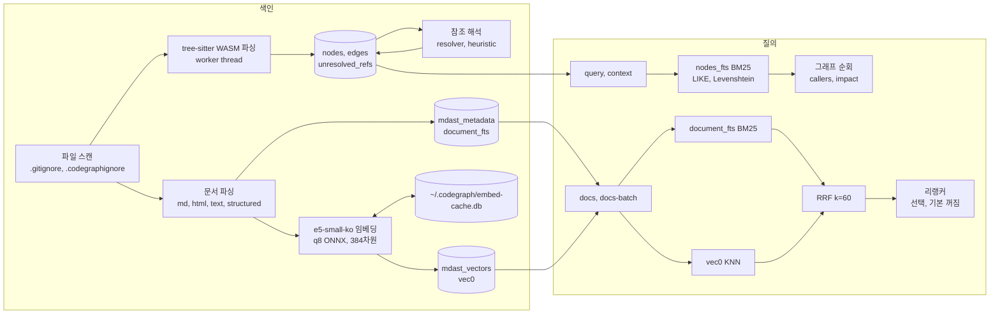
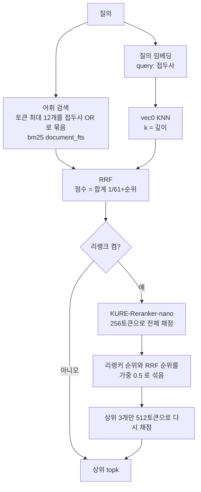

# codegraph 최신본 반영 상태와 구조 조사

- 작성: 2026-11-03, RIPER RESEARCH
- 상태 파일: `.claude/memory-bank/main/riper/main-2026-11-03-codegraph-structure.state`
- 짝 문서: [라이브러리 조사](main-2026-11-03-codegraph-structure-research-libraries.md)
- 범위: 사실 수집만 함. 선택과 제안은 INNOVATE 에서 함.

## 1. 결론 요약

- 이 폴더(`D:/Fork/codegraph`)는 KIT 최신본이 아님. KIT 커밋 `3e16c35`(2026-10-19, CodeGraph 1.1.0) 상태와 같음.
- KIT 최신본은 `e88354d`(2026-11-02)임. 그 사이 기능 커밋 3개가 이 폴더에 없음. 24개 파일, 1,059줄 추가, 42줄 삭제.
- 이 PC 의 전역 설치본은 1.1.2(`1.1.2-345c0b4f3c8e`)이고 KIT `d7b8e05` 상태임. 임베딩 캐시·잠금과 한국어 모델은 있음. `docs-batch` 와 리랭커는 없음.
- 최신본 구조: 내장 Node 24 의 `node:sqlite` 에 SQLite FTS5(BM25)와 sqlite-vec(`vec0`)를 얹음. 코드는 tree-sitter WASM 으로 파싱하고 BM25 로만 검색함. 문서는 BM25 와 벡터를 RRF 로 합침. 리랭커는 선택 기능이고 기본으로 꺼짐.

## 2. 최신본 반영 확인

### 2.1 비교 방법

- `diff -rq` 로 `D:/Fork/KIT/tools/codegraph` 와 이 폴더를 비교함.
- `git -C D:/Fork/KIT archive 3e16c35 tools/codegraph` 로 1.1.0 시점 파일을 풀어 이 폴더와 다시 비교함.
- 배포 zip 은 `sha256sum` 으로 manifest 의 값과 대조함.

### 2.2 결과

| 항목 | 이 폴더 | KIT HEAD |
|---|---|---|
| 기준 커밋 | `3e16c35` (2026-10-19) | `e88354d` (2026-11-02) |
| `source/package.json` 버전 | 1.1.0 | 1.1.2 |
| 문서 임베딩 모델 | `Xenova/multilingual-e5-small` | `dragonkue/multilingual-e5-small-ko` |
| 리랭커 모델 | 없음 | `nlpai-lab/KURE-Reranker-nano` (선택) |
| 배포 zip | 260,573,495 바이트, sha256 `10a01b51…` | 405,982,419 바이트, sha256 `6661d996…` |
| `docs-batch` 명령 | 없음 | 있음 |

- `source/`, `grammars/`, `build.mjs`, `install.ps1`, `install.sh`, `LICENSE` 는 KIT `3e16c35` 와 바이트까지 같음.
- `manifest.json` 은 KIT `3e16c35` 와 내용이 같음. 줄 끝 문자만 다름.
- zip 의 sha256 은 이 폴더 manifest 의 1.1.0 값과 같음. 따라서 zip 도 1.1.0 빌드임.
- `scripts/`(`add-lang`, `agent-eval`, `local-install.sh`)는 이 폴더에만 있음. KIT 배포본에 없는 저장소 전용 파일임.
- `source/node_modules` 는 KIT 에만 있음. 개발용 로컬 설치 폴더임.
- 동기화 커밋 `66e0c51`(2026-10-26) 시점에는 KIT 도 1.1.0 이었음. 그 뒤 KIT 가 3번 갱신됨.

### 2.3 이 폴더에 빠진 KIT 커밋

| 커밋 | 날짜 | 내용 | 바뀐 주요 파일 |
|---|---|---|---|
| `6437fb2`, `ddcf466` | 2026-10-27 | 문서 벡터 캐시와 전역 잠금, 1.1.1 | `docs/embed-cache.js`, `docs/embed-lock.js`, `docs/indexer.js` |
| `3a60e2d`, `d7b8e05` | 2026-10-28 | 임베딩 모델을 `multilingual-e5-small-ko` 로 교체, 1.1.2 | `docs/embed.js`, `docs/model-assets.js`, `manifest.json` |
| `e88354d` | 2026-11-02 | `docs-batch` 명령과 선택형 리랭커 | `bin/codegraph.js`, `docs/rerank.js`, `docs/search.js`, `build.mjs` |

- 테스트 4개도 빠짐: `docs-batch`, `docs-embed-cache`, `docs-model-mismatch`, `docs-rerank`.
- `e88354d` 는 버전 번호를 올리지 않음. 그래서 "1.1.2" 라는 버전만으로는 리랭커 포함 여부를 알 수 없음.

### 2.4 전역 설치본

- 실행 파일: `~/.local/bin/codegraph` 셸 스크립트가 `~/.local/share/team-tech-support-harness/codegraph/1.1.2-345c0b4f3c8e/win32-x64/node.exe` 를 부름.
- `codegraph --help` 에 `docs-batch` 가 없음. `lib/dist/docs/` 에 `rerank.js` 가 없음. `embed-cache.js` 와 `embed-lock.js` 는 있음.
- 같은 위치에 `1.1.1-df605202e12b` 설치본도 남아 있음.

## 3. 최신본 구조 (KIT HEAD `e88354d`)

### 3.1 실행 환경

- 소스는 CommonJS JavaScript(`source/lib/`)를 직접 관리함. 원래 TypeScript 소스는 남아 있지 않음(`source/README.md`).
- 배포본은 공식 Node 24.16.0 실행 파일, 의존성, 고정된 오프라인 모델을 함께 묶음. 설치기는 무결성 manifest 로 파일마다 검증함.
- 주요 의존성(`source/package.json`):

| 패키지 | 버전 | 쓰는 곳 |
|---|---|---|
| `node:sqlite` (Node 내장) | Node 24 | 모든 저장. `better-sqlite3` 는 타입만 남음 |
| `sqlite-vec` | ^0.1.9 | 문서 벡터 `vec0` 가상 테이블 |
| `@huggingface/transformers` | ^4.2.0 | 문서 임베딩과 리랭커(ONNX, q8) |
| `web-tree-sitter`, `tree-sitter-wasms` | ^0.25.3, ^0.1.11 | 코드 파싱 |
| `graphology`, `graphology-communities-louvain`, `graphology-metrics` | 0.26, 2.0, 2.4 | 커뮤니티 탐지와 보고서 |
| `chokidar` | ^4.0.3 | 파일 감시 데몬 |
| `commander` | ^14.0.2 | CLI |

### 3.2 전체 흐름

### 3.3 저장소 (SQLite)

- 연결: `lib/db/sqlite-adapter.js` 가 `node:sqlite` 의 `DatabaseSync` 를 better-sqlite3 모양으로 감쌈. `allowExtension: true` 로 열어 sqlite-vec 을 불러옴.
- 설정(`lib/db/index.js`): `busy_timeout=5000`, WAL, `synchronous=NORMAL`, 페이지 캐시 64MB, `temp_store=MEMORY`, mmap 256MB.
- 스키마 버전 11(`lib/db/migrations.js`). 주요 테이블:

| 테이블 | 종류 | 내용 |
|---|---|---|
| `nodes` | 일반 | 심볼. 위치, 시그니처, docstring, 공개 여부, 데코레이터 |
| `edges` | 일반 | 관계. `provenance` 열에 `tree-sitter`, `resolver`, `heuristic` 을 기록 |
| `unresolved_refs` | 일반 | 아직 해석하지 못한 참조와 후보 |
| `files`, `file_inventory` | 일반 | 파일 해시, 크기, 오류, 어댑터 상태 |
| `nodes_fts` | FTS5 (외부 콘텐츠) | `id, name, qualified_name, docstring, signature`. 트리거 3개로 `nodes` 와 맞춤 |
| `mdast_metadata` | 일반 | 문서 메타. 제목, 요약, BLK 태그, 코드 참조, 문서 링크, `embedding_model` |
| `document_fts` | FTS5 | `file_path, title, summary, structure`. 토크나이저 옵션 없음(기본 `unicode61`) |
| `mdast_vectors` | `vec0` | `embedding float[384]`. rowid 가 `mdast_metadata.id` |
| `semantic_edge_*` | 일반 | 문서 유사도 이웃 캐시 |

### 3.4 코드 추출 (tree-sitter)

- 문법: `lib/extraction/grammars.js` 에 언어 20개. TypeScript, TSX, JavaScript(JSX 포함), Python, Go, Rust, Java, C, C++, C#, PHP, Ruby, Swift, Kotlin, Dart, Pascal, Scala, Lua, Luau, Objective-C.
- 대부분은 `tree-sitter-wasms` 의 WASM 을 씀. C#(구버전, 최신 문법 두 벌), Lua, Luau, Pascal, Scala 는 저장소 안 `lib/extraction/wasm/` 의 WASM 을 씀.
- 별도 추출기: Vue, Svelte, Liquid, Delphi DFM, MyBatis. 어댑터: PTN(`lib/extraction/adapters/`).
- 파싱은 worker thread 에서 함(`parse-worker.js`). 파서는 5,000번 파싱마다 다시 만듦.
- C# 은 조건부 컴파일 변형마다 따로 파싱함. 그래도 오류가 나면 C# 11/12 문법으로 다시 파싱함(`source/README.md`).
- 파싱이 일부 실패한 파일은 남은 심볼과 진단을 유지함. 저장소 전체를 stale 로 만들지 않음.

### 3.5 참조 해석

- `lib/resolution/index.js` 가 해석 전략을 묶음. `exact-match`, `import`, `qualified-name`, `framework`, `file-path` 는 `resolver` 출처로 기록함. `fuzzy`, `instance-method` 는 `heuristic` 출처로 기록함.
- 프레임워크 해석기 21종: React, Vue, Svelte, Express, NestJS, Laravel, Drupal, Django 계열(python), Rails 계열(ruby), Go, Rust, Cargo workspace, C#, Java, Play, Swift, Swift-ObjC, React Native, Expo, Fabric 등(`lib/resolution/frameworks/`).

### 3.6 코드 검색

- 코드 심볼에는 벡터가 없음. 코드 검색은 어휘 검색과 그래프 순회만 씀.
- `searchNodes`(`lib/db/queries.js`): FTS5 `bm25(nodes_fts, 0, 20, 5, 1, 2)` 로 먼저 찾음. 열 가중치는 `name` 20, `qualified_name` 5, `signature` 2, `docstring` 1 임. 결과가 없으면 `LIKE` 부분 일치, 그다음 Levenshtein 거리로 찾음.
- `context`(`lib/context/index.js`): 자연어 질의에서 CamelCase, snake_case, 점 표기 같은 심볼 후보를 뽑음. FTS 결과를 그래프 순회로 넓혀 마크다운 문맥을 만듦.
- `query` 와 `context` 결과에는 문서 검색 결과(`docs`)도 함께 붙음.

### 3.7 문서 색인

- 대상: Markdown, HTML, 텍스트, 구조화 파일(`lib/docs/document-parsers/`). 문서 기능은 `project_metadata.docs_enabled` 나 `CODEGRAPH_DOCS` 로 켬.
- 파싱 결과(`parse.js`, `document-parsers/shared.js`):
  - `summary`: 본문 앞 600자
  - `embeddingText`: 제목, 요약, 섹션 최대 32개(머리말 경로 포함)를 이어 붙이고 12,000자에서 자름
- 임베딩(`embed.js`):
  - 모델 `dragonkue/multilingual-e5-small-ko`, q8 ONNX, 384차원, mean pooling 후 L2 정규화
  - 접두사: 문서 `passage: `, 질의 `query: `
  - 토큰은 앞에서부터 `model_max_length`(e5-small 계열은 512)까지만 씀. 12,000자 중 앞부분만 모델에 들어감
  - 배치 16개. 다음 배치 토큰화를 추론과 겹쳐 돌림
  - 문서 1개에 벡터 1개. 청크 단위 벡터는 없음
- 캐시(`embed-cache.js`): `~/.codegraph/embed-cache.db`. 키는 (모델 ID, 접두사 포함 입력 텍스트의 sha256). `CODEGRAPH_EMBED_CACHE=off` 로 끔.
- 잠금(`embed-lock.js`): PC 전체에서 임베딩은 한 프로세스씩 함. 소유 프로세스가 죽거나 120초 동안 갱신이 없으면 잠금을 빼앗음.
- 모델 불일치: 저장된 벡터의 모델이 지금 모델과 다르면 벡터 단계를 건너뛰고 어휘 결과만 돌려줌. `semanticState: "stale"` 과 경고를 붙임.

### 3.8 문서 검색

- 어휘 검색(`lexical-search.js`): 질의에서 글자·숫자·`_./-` 토큰을 뽑아 소문자로 바꿈. 최대 12개를 `"토큰"*` 꼴의 접두사 질의로 만들어 OR 로 묶음.
- 벡터 검색(`search.js`): `mdast_vectors` 에 `MATCH ? AND k = 깊이` 로 질의함. sqlite-vec 의 전수 비교(brute force)임.
- 결합: RRF. 각 결과에 `1/(61+순위)` 를 더함(순위는 0부터, 상수는 60). 기본 topk 8, 최대 50.
- 리랭커(`rerank.js`, 기본 꺼짐):
  - 켜는 방법: `--rerank` 또는 `CODEGRAPH_DOCS_RERANK=1`. 깊이는 `--rerank-depth`(기본 10)
  - 모델 `nlpai-lab/KURE-Reranker-nano`, q8, 스레드 기본 8(`CODEGRAPH_RERANK_THREADS`)
  - 리랭커 입력 텍스트: 제목 + `document_fts.structure`(요약 중복 제거)
  - 모델 로딩을 질의 임베딩과 동시에 시작함. 실패하면 RRF 순서를 그대로 씀
- `docs-batch`: 한 프로세스에서 여러 질의를 처리함. 모델을 한 번만 불러옴. 동기화, 감시, 잠금, git 호출이 없음.

### 3.9 그래프 분석과 문서 그래프

- 커뮤니티: `graphology` 무방향 그래프에 Louvain 을 돌림. 결과는 파생 캐시로 저장함(`lib/graph/community-*.js`).
- 보고서: god node, 순환 import, 의외의 연결, 질문 후보(`lib/graph/report-*.js`).
- 문서 그래프: `governs` 연결, Obsidian 식 문서 링크 승격(순수 마크다운 프로젝트만), 문서 유사도 엣지(top-k 5, 유사도 0.75 이상). 유사도 엣지는 켜야 만들어짐.

### 3.10 동기화와 감시

- 감시 데몬: chokidar 로 파일 변경을 받음. 300ms 동안 모아 증분 동기화함. 30분 동안 요청이 없으면 멈춤(`CODEGRAPH_WATCH_IDLE_MS`).
- `CODEGRAPH_NO_WATCH=1` 로 자동 시작을 끔. `--no-sync` 질의는 저장된 스냅숏만 읽음.
- 감시 데몬이 준비되었고 대기 파일이 없으면, 일반 질의는 데몬이 게시한 결과를 바로 읽음. 아니면 질의가 직접 맞춤(reconcile).

## 4. 실사용 코퍼스 기준선

### 4.1 색인 통계 (2026-11-03, 읽기 전용 `node:sqlite` 로 조회)

| 코퍼스 | 쓰임새 | 코드 파일 | 노드 | 엣지 | 미해석 참조 | 문서 | 문서 평균 길이(structure) |
|---|---|---|---|---|---|---|---|
| `D:/Fork/RX_1` | C# Unity, 호출 결합도 높음 | 223 (C# 213) | 7,167 | 14,474 | 7,621 | 133 | 5,152자 |
| `D:/Fork/Arcyn` | Unity + Burst + ECS | 2,196 (C# 2,108) | 67,093 | 161,691 | 84,619 | 562 | 5,901자 |
| `D:/Fork/BLADE` | 한국어 소설 설정 | 1 | 1,369 | 2,315 | 0 | 1,369 | 901자 |
| `D:/Fork/.AI/위탁과제_원자그래프` | 한국어 사업계획서 원자 | 0 | 469 | 4,590 | 0 | 469 | 1,241자 |
| `D:/Fork/.AI/guide/Zyxel-official/graph` | 영어 사용자 매뉴얼 | 0 | 9,929 | 42,591 | 0 | 9,929 | 1,408자 |

- 다섯 곳 모두 문서 벡터가 `dragonkue/multilingual-e5-small-ko` 한 모델로 되어 있음.
- 문서 유사도 엣지(`semantic_edge_neighbors`)는 다섯 곳 모두 0개임.
- 엣지 출처: RX_1 은 tree-sitter 6,900, resolver 6,597, heuristic 977. Arcyn 은 tree-sitter 64,900, resolver 84,840, heuristic 11,951. 문서 코퍼스 세 곳은 모두 resolver.
- 사용자가 말한 규모와 색인 규모가 다름. BLADE 는 약 1,500개라고 했고 색인 문서는 1,369개임. Zyxel 은 약 15,000개라고 했고 색인 문서는 9,929개임.
- Arcyn 의 `.codegraphignore` 는 Unity 캐시(`Library/` 등), 참조하지 않는 외부 코드, 에이전트 설정 폴더를 뺌. 문서 코퍼스 두 곳(위탁과제, Zyxel)은 `*` 로 모두 뺀 뒤 `!*.md` 만 다시 넣음.

### 4.2 질의 시간 (설치본 1.1.2, `CODEGRAPH_NO_WATCH=1`, 1회 측정)

| 명령 | 코퍼스 | 시간 |
|---|---|---|
| `docs "검 수련 장면" --no-sync --limit 5` | BLADE | 1,868ms |
| `docs "사업화 전략 매출 목표" --no-sync --limit 5` | 위탁과제 | 1,740ms |
| `docs "configure VLAN on switch port" --no-sync --limit 5` | Zyxel | 2,207ms |
| `query "PlayerController" -l 5` | RX_1 | 1,870ms |
| `query "SystemBase" -l 5` (신선도 검사 포함) | Arcyn | 29,875ms |
| `query "SystemBase" -l 5 --no-sync` | Arcyn | 1,842ms |
| `context "damage calculation on hit"` (신선도 검사 포함) | Arcyn | 7,548ms |
| `context "damage calculation on hit" --no-sync` | Arcyn | 2,303ms |

- 측정 한계: 한 번씩만 잼. 시간에는 프로세스 시작과 임베딩 모델 로딩이 들어 있음. 정답 여부(품질)는 재지 않음.
- Arcyn 에서 신선도 검사 비용이 큼. 같은 `query` 가 검사를 하면 29.9초, 건너뛰면 1.8초임. 검사 대상 파일은 3,595개였음.
- RX_1 의 `PlayerController` 는 심볼 결과 0개였고 문서 결과만 나옴.

### 4.3 앞서 기록된 측정 (KIT `references/DOC_GRAPH_POLICY.md`)

- 3절: 옛 `multilingual-e5-small` 은 한국어 질의에서 `all-MiniLM-L6-v2` 보다 좋았음(Hit@5 7 → 13건, MRR 0.26 → 0.46). 모델을 바꾼 뒤 동기화하지 않은 소설 그래프는 Hit@1 20.00, 다시 동기화한 뒤 83.33.
- 5절: 로컬 CPU 임베딩은 문서당 약 0.09초(노트 1,378개 119초).
- 6절(i7-12700H): 캐시에 벡터가 있으면 노트 1,378개 20초, Zyxel 9,929개 47초. 전부 다시 임베딩하면 119초, 1,930초.
- 8절(Unity 코드 저장소 문서 그래프, 검증 질의 40개): 원문 질의 Hit@1 45.00, Hit@5 67.50. 조사 떼기와 영어 이름 붙이기 뒤 Hit@1 65.00, Hit@5 92.50. 후보 50개에서 md 상위 5개를 보면 Hit@1 75.00.
- 8절 리랭커: 검증 질의에서 깊이 50 은 Hit@5 92.50 → 95.00, Hit@1 은 75.00 그대로. 개발 질의에서는 Hit@1 60.00 → 40.00, Hit@5 95.00 → 85.00. 질의 한 건당 3~9초가 더 듦(`rules/doc-graph.md`, 2026-11-02 측정).

### 4.4 한 프로세스 안의 연속 질의 시간 (KIT 소스 `docs-batch`, 2026-11-03)

- 방법: 설치본 1.1.2 의 `node.exe` 와 모델 폴더로 KIT HEAD 소스의 `docs-batch` 를 돌림. 질의 8개, `--limit 5`, 리랭커 끔. 질의는 이 조사에서 임의로 쓴 것이고 정답 표가 없음.

| 코퍼스 | 문서 | 질의 8개 합계(`totalMs`) | 질의당 평균 | 프로세스 전체 |
|---|---|---|---|---|
| BLADE (2회째, 3회째) | 1,369 | 1,141ms, 1,192ms | 약 145ms | 1,679ms, 1,829ms |
| Zyxel | 9,929 | 1,313ms | 약 164ms | 1,889ms |
| 위탁과제 | 469 | 1,188ms | 약 149ms | 1,762ms |
| Arcyn (문서) | 562 | 1,184ms | 약 148ms | 1,791ms |

- 질의당 평균에는 첫 질의의 모델 로딩이 들어 있음. 모델 로딩을 뺀 질의 1건 시간은 따로 재지 않음.
- BLADE 첫 실행은 6,156ms 였음. 같은 명령을 다시 돌리면 1.1초대로 내려감. 첫 실행은 모델 파일이 디스크 캐시에 없던 상태로 보임.
- 문서 수가 7배 넘게 차이 나는 BLADE 와 Zyxel 의 합계 차이는 약 0.1~0.2초임.
- BLADE 8개 질의 모두 `semanticState: ready` 였음. 상위 5개 결과는 어휘만, 벡터만, 둘 다(`lexical+vector`)가 섞여 있었음.

### 4.5 검색 종류별 품질·속도 근거 현황

목표: 맥락 검색과 키워드 검색이 높은 품질과 빠른 속도를 함께 유지하는지 확인함. 아래 표는 지금 근거가 있는 칸과 없는 칸을 나눔.

| 검색 | 명령과 경로 | 속도 근거 | 품질 근거 |
|---|---|---|---|
| 코드 키워드 | `query`: nodes_fts BM25, LIKE, Levenshtein | 4.2절. `--no-sync` 1.8초(프로세스 전체). 신선도 검사 포함 시 Arcyn 29.9초 | 없음. 코드 심볼 검색의 Hit@k 측정을 찾지 못함 |
| 코드 맥락 | `context`: FTS + 그래프 순회 | 4.2절. `--no-sync` 2.3초, 검사 포함 7.5초 | 없음 |
| 문서 키워드 | `docs` 의 어휘 단계: document_fts BM25 | 따로 재지 않음 | 위탁과제 어휘만: Hit@5 34.09, 조사 떼면 50.00 (atom-eval, 2026-10-15) |
| 문서 맥락(하이브리드) | `docs`: BM25 + vec0 + RRF | 4.2절, 4.4절 | 위탁과제, Arcyn 문서, BLADE 에 있음(아래). Zyxel, RX_1 은 찾지 못함 |
| 문서 + 리랭커 | `docs --rerank` | 질의당 3~9초 추가(`rules/doc-graph.md`) | Arcyn 문서: 검증 Hit@1 그대로, 개발 Hit@1 하락 |

- 위탁과제 원자 그래프(`D:/Fork/.AI/context/atom-eval/README.md`, 문서 444개, 질문 44개):
  - e5-small-ko + 어휘(RRF): Recall@10 68.84, Hit@5 72.73, MRR@10 51.45
  - e5-small-ko 벡터만: Recall@10 72.71, Hit@5 93.18, MRR@10 64.68
  - 이 측정에서는 벡터만 쓴 쪽이 하이브리드보다 높았음. README 는 RRF 에서 어휘 비중을 0.87 아래로 낮추면 상위 10개가 벡터 순위로 채워진다고 적음.
  - e5 접두사(`query:`, `passage:`)는 e5-small-ko 에서 효과가 없었음(Recall@10 72.71 대 71.29). 이 측정은 1.0.4 처리 방식을 Python 으로 옮긴 재현이고 모델은 fp32 임. 지금 CLI 는 q8 과 접두사를 씀.
- Arcyn 문서(`D:/Fork/.AI/context/arcyn-docs-eval/README.md`, 2026-11-02): 4.3절의 8절 값과 같음. 최고 검증 Hit@1 75.00.
- BLADE: 3절 값(질문 30개, 동기화 뒤 Hit@1 83.33). 정답 표 파일은 BLADE 폴더에서 찾지 못함.
- 관련 기록(이 조사에서 열지 않음): `D:/Fork/.AI/trails/2026-10-29-bm25-cross-encoder-codegraph.md`, `D:/Fork/.AI/plans/2026-10-30-codegraph-docs-rerank-resident.md`, `D:/Fork/.AI/plans/2026-10-30-blade-rag-operations-proposal.md`.
- 이 저장소의 `docs/benchmarks/` 3편은 업스트림 0.9.4(2026-05) 에이전트 A/B 측정임. 파일 읽기 수와 소요 시간을 잼. 검색 순위 품질은 재지 않음.

## 5. 조사 중 드러난 사실 (INNOVATE 입력)

판단 없이 사실만 적음.

- 코드 심볼에는 임베딩이 없음. 코드 쪽 "하이브리드"는 지금 없음.
- 문서 임베딩은 문서 하나에 벡터 하나이고 앞 512토큰만 씀. 평균 5천자 넘는 RX_1, Arcyn 문서는 뒷부분이 벡터에 반영되지 않음.
- `embeddingText` 는 요약(앞 600자)과 첫 섹션 본문을 둘 다 담음. 같은 앞부분이 512토큰 안에서 두 번 들어갈 수 있음.
- `document_fts` 는 기본 `unicode61` 토크나이저를 씀. 한국어는 띄어쓰기 단위 토큰에 접두사 일치만 함. 조사가 붙은 어절은 질의 쪽에서 조사를 떼야 맞음(DOC_GRAPH_POLICY 8절).
- 벡터 검색은 sqlite-vec 전수 비교임. Zyxel 9,929개 기준 검색 1회는 위 측정에서 약 2.2초였고, 이 시간에는 모델 로딩이 들어 있음.
- 전역 설치본에는 `docs-batch` 와 리랭커가 없음. 이 폴더 소스에는 캐시·잠금·한국어 모델도 없음.
- 문서 검색 1건의 시간 대부분은 프로세스 시작과 모델 로딩임. 한 프로세스 안의 연속 질의는 질의당 약 150ms 였음(4.4절).
- 코드 검색 1건의 시간은 `--no-sync` 여부에 크게 달림. Arcyn 에서 29.9초와 1.8초였음(4.2절).
- 품질 측정은 문서 검색에만 있고 코드 키워드·맥락 검색에는 없음(4.5절).
- 위탁과제 측정에서 RRF 하이브리드는 벡터만 쓴 경우보다 낮았음. Arcyn 문서 측정에서 리랭커는 Hit@1 을 올리지 못했음.

## 6. 출처

- KIT 저장소: `D:/Fork/KIT/tools/codegraph` (HEAD `e88354d`), `git log -- tools/codegraph`
- 소스 파일: `source/lib/db/sqlite-adapter.js`, `db/schema.sql`, `db/index.js`, `db/migrations.js`, `db/queries.js`, `docs/indexer.js`, `docs/embed.js`, `docs/embed-cache.js`, `docs/embed-lock.js`, `docs/search.js`, `docs/lexical-search.js`, `docs/rerank.js`, `docs/model-assets.js`, `docs/document-parsers/shared.js`, `extraction/grammars.js`, `extraction/parse-worker.js`, `resolution/index.js`, `graph/community-split.js`, `sync/watcher.js`, `bin/codegraph.js`
- 문서: `source/README.md`, `D:/Fork/KIT/references/DOC_GRAPH_POLICY.md` 3, 5, 6, 8절
