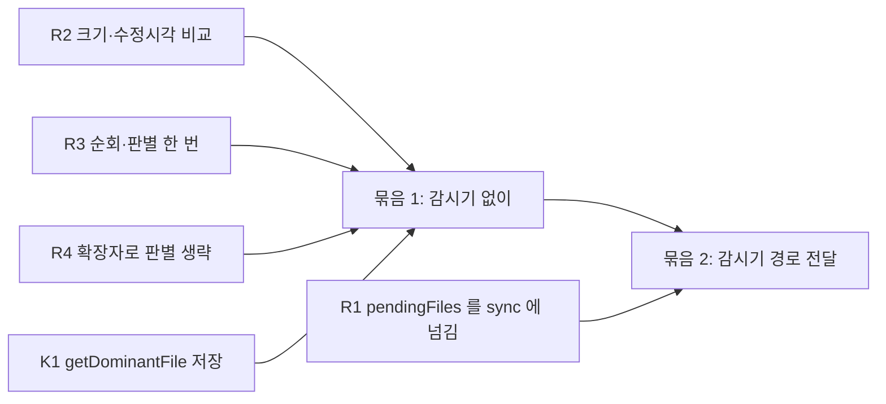

# 질의 속도 개선 발상 (2026-11-04)

- 조사 문서: `main-2026-11-04-codegraph-sync-speed-research.md`
- 상태 파일: `.claude/memory-bank/main/riper/main-2026-11-04-codegraph-sync-speed.state`
- 사용자 제안(2026-11-04): 바뀐 파일과 거기에 물린 이웃 파일만 국소 sync. 감시기(watcher)가 바뀐 파일 경로를 이미 알고 있지 않느냐.

## 1. 지금 코드에서 확인한 사실

- 감시기는 chokidar 이벤트마다 파일 경로를 받아 `pendingFiles` 에 적는다(`lib/sync/watcher.js:208-236`).
- 그러나 sync 를 부를 때 경로를 넘기지 않는다. `await this.syncFn()` (`lib/sync/watcher.js:379`). 그래서 감시기가 돌려도 sync 는 트리 전체를 다시 훑는다. 경로는 "결과가 낡았을 수 있음" 표시에만 쓴다.
- 코드 쪽 "이웃" 처리는 이미 있다. 바뀐 파일의 미해결 참조와, 바뀐 심볼 이름에 맞는 다른 파일의 미해결 참조만 다시 해결한다(`lib/index.js:599-621`).
- 문서 쪽 링크 재연결(`linkGovernsEdges`, `linkDocEdges`)은 하나라도 바뀌면 DB 전체를 대상으로 돈다(`lib/index.js:625-671`).
- 비용이 큰 곳은 바뀐 것을 찾는 단계다. 바뀐 것을 처리하는 단계는 아니다. 바뀐 것이 없을 때도 문서 스캔(`indexMarkdown`)과 파일 목록 갱신(`refreshFileInventory`)이 소스 아닌 파일을 모두 연다(`lib/index.js:646-707`, 조사 문서 1, 2절).
- 사용자 규칙은 설치와 검색 모두 `CODEGRAPH_NO_WATCH=1` 로 감시기를 끈다(`rules/doc-graph.md`). 감시기는 30분 쉬면 스스로 멈춘다.

## 2. 사용자 제안의 두 부분

| 부분 | 지금 | 제안 반영 시 |
|---|---|---|
| 무엇이 바뀌었나 찾기 | 질의마다 트리 전체 순회 + 소스 아닌 파일 전부 열기 | 감시기 경로 목록, 또는 저장된 크기·수정 시각 비교 |
| 바뀐 것 처리 | 코드: 바뀐 파일만 다시 파싱, 이웃 참조만 다시 해결. 문서: 링크 재연결은 전체 | 문서 링크 재연결도 바뀐 문서 주변으로 좁힘 |

시간은 거의 다 첫 줄에서 쓴다. 그래서 제안의 효과는 "바뀐 것을 싸게 찾는 방법"에 달려 있다.

## 3. 선택지

### 바뀐 것 찾기

| 표시 | 방법 | 질의당 sync 비용 | 놓치는 경우 | 필요한 결정 |
|---|---|---|---|---|
| R1 | 감시기가 `pendingFiles` 경로를 sync 에 넘기고, 그 파일만 다시 처리함 | 감시기가 준비돼 있으면 0 에 가까움(질의는 지금도 준비된 감시기가 있으면 맞추기를 건너뜀) | 감시기가 꺼져 있던 동안의 변경. 대량 변경(git checkout, Unity 재임포트) 때 Windows 변경 버퍼 넘침 | 감시기를 다시 켤지(`CODEGRAPH_NO_WATCH` 정책) |
| R2 | 저장된 크기와 수정 시각(파일 목록 표에 이미 있음)과 비교해, 같은 파일은 열지도 `realpath` 하지도 않음 | 트리 순회만 남음. 프로파일 비율로 지금의 20% 안팎(추정, 측정 안 함) | 크기와 수정 시각이 그대로인 내용 변경(드묾) | 없음 |
| R3 | 트리 순회를 한 번만 하고 코드 추출, 문서 스캔, 파일 목록 갱신이 같은 목록과 같은 판별 결과를 씀 | 순회 3번이 1번으로, 판별 2번이 1번으로 | 없음 | 없음 |
| R4 | 확장자로 바이너리(`.png`, `.wav`, `.fbx`, `.exr` 등)는 열지 않고, 확장자로 텍스트인 것(`.md` 등)은 내용을 실제로 읽을 때만 검사함 | Arcyn 바이너리 약 700개, BLADE `.md` 1370개 열기를 없앰 | 확장자와 내용이 다른 파일 | 바이너리 확장자 목록 |

- R1 도 감시기가 시작할 때 한 번은 전체 맞추기가 필요하다. 꺼져 있던 동안의 변경을 모르기 때문이다. R2, R3, R4 는 그 시작 비용도 줄인다.
- R2 만으로는 질의마다 트리 순회(`readdir`, `stat`)가 남는다. 순회 비용은 Arcyn 프로파일에서 약 1.8초(프로파일러 켠 값, 전체 10.2초 중)였다.

### 바뀐 것 처리 (이웃)

| 표시 | 방법 | 효과 |
|---|---|---|
| N1 | 문서 링크 재연결을 바뀐 문서와 그 문서를 가리키는 문서로 좁힘 | 문서가 바뀐 sync 만 빨라짐. 바뀐 것 없는 sync 에는 영향 없음 |

### context 자체

| 표시 | 방법 | 효과 |
|---|---|---|
| K1 | `getDominantFile` 결과를 sync 때 계산해 `project_metadata` 에 저장하고, context 는 읽기만 함 | context 마다 약 0.69초(프로파일러 켠 값) 절약 |
| K2 | context 의 관련 문서 부분이 임베딩 모델을 읽는 비용을 줄임. 예: 어휘 검색만 쓰는 선택, 또는 여러 질의를 한 프로세스에서 처리 | context 마다 약 1.6초(모듈 적재와 토크나이저) 절약 가능. 문서 결과 품질은 바뀔 수 있음 |

## 4. 묶음

- 묶음 1: R2, R3, R4, K1. 정책을 바꾸지 않는다. 감시기를 켜도 그 시작 비용과 감시기 sync 비용이 함께 준다.
- 묶음 2: 묶음 1 위에 R1. 감시기를 켜야 한다. 켜면 준비된 감시기가 있는 동안 질의는 sync 를 건너뛴다.
- N1, K2 는 따로 판단한다. K2 는 문서 결과 품질에 영향이 있어 측정이 필요하다.

## 5. 신선도를 지키며 sync 시간 줄이기 (사용자 요청 2026-11-04)

- 코드 sync 는 이미 R2 방식이다. 저장된 크기와 수정 시각이 같은 파일은 읽지도 해시하지도 않는다(`extraction/index.js:1259-1267` 주석과 코드). `git status` 는 믿지 않는다. `git pull`, `checkout` 뒤에는 작업 트리가 깨끗해서 바뀐 것을 못 보기 때문이다.
- 문서 스캔과 파일 목록 갱신만 이 규칙을 쓰지 않는다. R2 는 코드 쪽이 이미 받아들인 신선도 기준을 그 둘에 똑같이 적용하는 일이다. 놓치는 경우도 코드 쪽과 같다(크기와 수정 시각을 그대로 둔 채 내용만 바뀐 파일).
- R3 은 같은 입력을 한 번만 계산하므로 신선도에 영향이 없다.
- R4 는 바이너리 확장자 파일에만 판별을 생략한다. 이 파일은 지금도 판별에서 떨어져 문서가 되지 않고 목록에 `metadata-only` 로 남는다. 텍스트 확장자 파일은 R2 가 다시 읽을지를 정하고, 판별은 내용을 실제로 읽을 때 한다.
- K1 은 sync 끝에 코드가 바뀌었을 때만 다시 계산해 저장한다. 그래프와 같은 시점의 값이다.

## 6. 감시기 상시 운용: 측정

측정: 2026-11-04, Arcyn, 배포본 `1.1.2-8e92ff564f22`, `GIT_OPTIONAL_LOCKS=0`. 측정 뒤 `codegraph watch stop` 으로 멈췄고 프로세스 종료를 확인했다. Arcyn 파일은 고치지 않았다.

| 항목 | 값 |
|---|---|
| `watch start` 반환 | 0.9초 |
| 시작부터 준비(ready)까지 | 57.5초. 그중 첫 전체 sync 9.5초. 이 사이 CPU 사용 10.2초(나머지는 디스크 대기) |
| 메모리 | 작업 집합 161MB, 전용 202MB |
| 핸들, 스레드 | 3,562개, 13개. chokidar 4.0.3 이 디렉터리마다 감시를 하나씩 둠 |
| 쉴 때 CPU | 코어 하나의 2.03% (20초 측정) |
| 준비된 감시기와 `query` | 0.54~0.65초 (sync 포함 3.2~3.7초, `--no-sync` 0.47~0.65초) |
| 준비된 감시기와 `context` | 2.0~2.35초 (sync 포함 4.8~5.5초, `--no-sync` 1.9~2.2초) |
| 쉬는 감시기 옆 수동 `sync` | 355ms, 막히지 않음 |

- 측정하지 않은 것: 파일을 고친 뒤 결과에 반영되기까지의 시간. 코드상 300ms 를 모은 뒤 전체 sync(Arcyn 3.2~9.5초)를 한다(`worker.js:159`, `watcher.js:379`).
- 등록된 감시기는 17개다(`~/.codegraph/watchers`). 마지막 CLI 요청 뒤 30분이 지나면 멈춘다(`worker.js:10, 196-202`). 그래서 동시에 도는 수는 최근 30분 안에 쓴 프로젝트 수다.

## 7. 감시기를 끈 이유: 기록과 지금 코드

| 번호 | 끈 이유 | 출처 | 지금 코드 | 상태 |
|---|---|---|---|---|
| 1 | 설치기가 활성 감시기를 모두 새 런타임으로 옮겨 한꺼번에 다시 임베딩함 | KIT `references/DOC_GRAPH_POLICY.md:25` | 설치기 `Upgrade-Watchers` 가 레지스트리의 모든 감시 프로젝트를 새 런타임으로 다시 띄움 | 남아 있음 |
| 2 | 시험 색인과 질의 때 감시기가 떠서 파일 잠금을 쥠 | 같은 문서 `:26` | 감시기는 sync 하는 동안만 잠금을 잡음. 감시기가 sync 중이면 질의의 sync 는 `blocked` 를 받고 150ms 마다 최대 30초 다시 시도함(`bin/freshness.js:27-34`). 감시기가 끝난 뒤 질의가 다시 전체 sync 를 함 | 일부 남음 |
| 3 | 감시기 sync 의 `git status` 가 `.git/index.lock` 을 잡아 사용자의 git 작업을 막음 | 같은 문서 `:54-56` | `--no-optional-locks` 를 씀(`extraction/index.js:301`). sync 경로는 `git status` 를 쓰지 않음 | 해소됨 |
| 4 | `--no-sync` 없는 질의가 끝날 때 감시기를 띄움 | 같은 문서 `:8`, `:70` | `autoWatch` (`bin/watch-command.js:22-43`) | 정책 문제 |
| 5 | (기록 밖) 런타임이 다른 CLI 끼리 서로의 감시기를 멈추고 다시 띄움 | `watch/manager.js:57-60`, SL 이식 trail C9 | KIT 소스 CLI 와 설치본을 같은 프로젝트에 번갈아 쓰면 57초 시작이 반복됨 | 남아 있음 |
| 6 | (로그) `watcher.json` 이름 바꾸기 `EPERM` | BLADE `.codegraph/watcher.log` 2건 | 감시기가 1초마다 `watcher.json` 을 임시 파일로 써서 이름을 바꿈(`worker.js:196-204`). 다른 프로세스가 그 파일을 열고 있으면 Windows 가 거부함 | 남아 있음 |

## 8. 득실

| 얻는 것 | 잃는 것 |
|---|---|
| 신선한 결과를 `--no-sync` 속도로 받음. Arcyn `query` 3.2~3.7초가 0.54~0.65초, `context` 4.8~5.5초가 2.0~2.35초 | 프로젝트마다 메모리 160~200MB, 핸들 3,500여 개, 쉴 때 CPU 코어 하나의 약 2%. 최근 30분 안에 쓴 프로젝트 수만큼 곱해짐 |
| 저장한 변경이 사용자 조작 없이 반영됨 | 시작 57초 동안 질의는 자기 sync 를 하고, 감시기의 첫 sync 와 잠금을 다툴 수 있음 |
| 질의마다 트리를 훑지 않음 | 감시기 sync 중에 온 질의는 그 sync 가 끝날 때까지 기다린 뒤 한 번 더 전체 sync 를 함 |
| | 감시기 sync 도 변경 하나마다 전체를 훑음(R1 없음) |
| | 설치 때 활성 감시기 전부가 새 런타임으로 옮겨짐(7절 1번) |

## 9. 풀 수 있는가

| 표시 | 대상 | 방법 | 위험과 확인할 것 |
|---|---|---|---|
| W1 | 8절 넷째 줄 | R1 과 같음. `pendingFiles` 경로만 sync 함. 감시기 시작 때와 이벤트 유실이 의심될 때는 전체 맞추기 | 대량 변경(git checkout, Unity 재임포트) 때 Windows 변경 버퍼가 넘치는지 측정 필요 |
| W2 | 7절 2번, 8절 셋째 줄 | 감시기가 sync 중이면 질의가 자기 sync 를 하지 않고 감시기의 sync 끝을 IPC 로 기다림 | 감시기가 멈추거나 응답하지 않을 때의 시간 제한 |
| W3 | 7절 6번 | `watcher.json` 을 상태가 바뀔 때만 쓰고, `EPERM` 은 다음 주기에 다시 씀 | 상태 확인이 파일 대신 IPC 를 쓰는지 확인 |
| W4 | 시작 57초, 핸들 3,562개 | Windows 에서만 `fs.watch(root, { recursive: true })` 한 개로 바꾸고 무시 규칙은 이벤트에서 거름. 처음 파일 목록 훑기가 없어짐 | Unity Editor 가 켜져 있으면 `Library/` 변경 이벤트가 JS 까지 와서 CPU 를 씀. 측정 필요. Linux 감시 한도 문제(#276)는 Windows 에 없음 |
| W5 | 7절 1번 | 설치기가 활성 감시기를 옮기지 않고 멈추기만 함. 다음 사용 때 새 런타임으로 뜸 | 임베딩 캐시가 같은 모델과 같은 텍스트는 다시 계산하지 않으므로, 실제로 무거운 경우는 모델이나 임베딩 텍스트가 바뀌는 설치뿐(안 C 가 해당) |
| W6 | 7절 5번 | 개발 중 KIT 소스 CLI 는 계속 `CODEGRAPH_NO_WATCH=1` 로 부름 | 정책만으로 해결 |

- R2, R3, R4 는 감시기의 시작 sync 와 변경마다 하는 sync 도 줄인다. 그래서 묶음 1 은 감시기를 켜든 끄든 이득이다.

## 10. 묶음 (수정)

- 묶음 1: R2, R3, R4, K1. 신선도 기준은 코드 쪽과 같다. 정책 변경 없음.
- 묶음 2: W1, W2, W3, W5. 감시기를 상시 운용할 때 남는 비용을 줄인다. 그 뒤 질의 규칙에서 `CODEGRAPH_NO_WATCH=1` 을 빼고, 설치와 시험에만 남긴다.
- W4 와 K2 는 측정이 먼저다. W4 는 Unity Editor 를 켠 상태의 CPU, K2 는 문서 결과 품질.

## 11. 사용자에게 물을 것

1. 묶음 1 을 PLAN 으로 보내도 되는가.
2. 감시기 상시 운용을 목표로 할지. 그러면 묶음 2 를 묶음 1 뒤에 PLAN 으로 보낸다.
3. W4 측정(Unity Editor 를 켠 Arcyn 에서 감시기 CPU)을 할지.

## 12. 사용자 결정 (2026-11-04)

- 묶음 1 을 먼저, 그다음 묶음 2 를 PLAN 으로 보낸다. 플랜은 묶음마다 하나씩, 두 개로 나눈다(RULE-7 의 10단계 제한).
- 실행 순서: 묶음 1 EXECUTE, REVIEW, G2 를 마친 뒤 묶음 2 를 시작한다. 안 B 는 그 뒤에 다시 시작한다.
- W4 와 K2 는 이번 플랜에 넣지 않는다. 측정이 먼저다.
- 묶음 1, 2 는 `lib/index.js` 의 `sync` 와 `context/index.js` 를 바꿀 수 있다. 안 B, C 플랜의 변경 전 문구가 그 파일에 걸려 있으므로, 안 B 를 다시 시작하기 전에 루트 세션이 그 문구가 실제 파일과 맞는지 다시 확인한다.

## 라벨

- R1~R4: 바뀐 것을 찾는 방법 후보. 출처는 이 문서 3절 첫 표. 각각 감시기 경로 전달, 크기·수정 시각 비교, 순회 한 번, 확장자로 판별 생략.
- N1: 문서 링크 재연결 범위를 좁히는 후보. 출처는 이 문서 3절 둘째 표.
- K1, K2: context 비용 후보. 출처는 이 문서 3절 셋째 표. 각각 `getDominantFile` 저장, 문서 부분 모델 로딩 줄이기.
- W1~W6: 감시기 상시 운용의 비용을 줄이는 후보. 출처는 이 문서 9절 표.
- 묶음 1, 묶음 2: 이 문서 10절의 조합.
