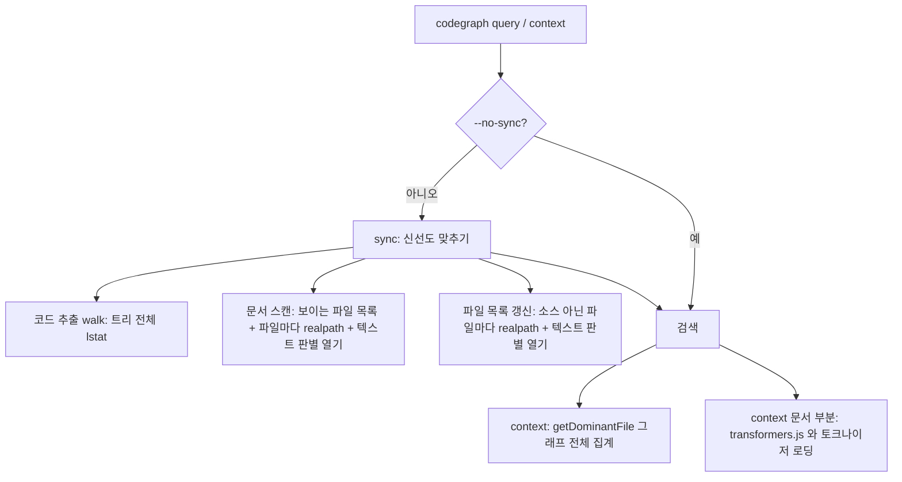

# 질의 속도 조사: sync 와 context 비용 (2026-11-04)

- 상태 파일: `.claude/memory-bank/main/riper/main-2026-11-04-codegraph-sync-speed.state`
- 대상 코드: KIT `tools/codegraph/source` (안 A 반영본, 전역 설치본 `1.1.2-8e92ff564f22` 과 같음)
- 측정 프로젝트: `D:/Fork/Arcyn` (주), `D:/Fork/RX_1`, `D:/Fork/BLADE` (파일 수만)

## 요약

- 안 A sweep 의 Arcyn 코드 `1469 ms/질의` 는 1.5초다. 시험 문항 하나마다 키워드 검색 1번과 `findRelevantContext` 1번을 더한 평균이다.
- 한 프로세스 안에서 키워드 검색(`searchNodes`)은 평균 16~29 ms 이다. 맥락 검색(`findRelevantContext`)은 평균 456~869 ms, 최대 1842 ms 이다.
- CLI 를 한 번 부를 때 실제 비용은 아래와 같다. 시간의 대부분은 검색이 아니라 sync 와 모델 로딩이다.
- 조사 단계에서 잰 "query sync 29.9초" 는 다시 나오지 않았다. 지금 코드로는 3.2~3.7초다.

| 명령 (Arcyn, CODEGRAPH_NO_WATCH=1) | sync 포함 | `--no-sync` |
|---|---|---|
| `codegraph query DamageHitJob --limit 3` | 3151~3661 ms | 465 ms |
| `codegraph context "inventory grid layout"` | 4809~5522 ms | 1940~2198 ms (한 번 4931 ms) |

## 원인 세 가지

1. **sync 가 바뀐 것이 없어도 파일을 전부 다시 연다.** 문서 스캔과 파일 목록 갱신이 소스가 아닌 파일마다 `realpath` 를 부르고, 파일을 열어 앞 8KB 를 읽어 텍스트인지 판별한다. 같은 일을 한 sync 에서 두 번 한다. 확장자로 이미 바이너리임을 아는 `.png`, `.wav`, `.fbx` 도 연다. 저장된 크기와 수정 시각을 보고 건너뛰지 않는다.
2. **context 가 부를 때마다 그래프 전체를 집계한다.** `getDominantFile` 은 질의와 상관없는 값인데 매번 모든 간선을 노드와 두 번 조인해 파일별로 센다.
3. **context 가 부를 때마다 임베딩 모델을 읽는다.** 관련 문서 부분이 벡터 검색을 하므로 transformers.js 모듈과 토크나이저를 프로세스마다 새로 만든다.

## 1. sync 비용 분해

측정: `node --cpu-prof --cpu-prof-interval 500 <KIT>/lib/bin/codegraph.js query DamageHitJob -p D:/Fork/Arcyn --limit 3`. CLI 는 실제 일을 자식 프로세스에서 한다(부모는 `spawnSync` 로 기다림). 아래는 자식 프로세스 프로파일이다. 프로파일러를 켜면 전체가 14.4초로 늘어나므로 절대값보다 비율을 본다.

| ms | 시스템 호출 | 호출 경로 (codegraph 쪽) |
|---|---|---|
| 2408 | realpath | `isPathWithinRootReal` `lib/utils.js:170` ← `listTextDocumentFiles` `docs/scan-files.js:97` ← `indexMarkdown` `docs/indexer.js:62` |
| 2031 | open | `isLikelyTextFile` `docs/scan-files.js:205` ← `classifyTextDocument` `:113` ← `listTextDocumentFiles` ← `indexMarkdown` |
| 1673 | open | `isLikelyTextFile` ← `classifyTextDocument` ← `classifyFile` `inventory/classifier.js:44` ← `refreshFileInventory` `inventory/index.js:44` |
| 1170 | lstat | `walk` `extraction/index.js:411` (코드 추출 쪽 트리 순회) |
| 647 | readdir | `walkVisibleFiles` `docs/scan-files.js:170` ← `listVisibleFiles` `:80` |
| 544 | realpath | `isPathWithinRootReal` ← `classifyFile` ← `refreshFileInventory` |
| 436 | open | `isLikelyTextFile` ← `listTextDocumentFiles` (형식 있는 문서) |
| 397 | stat | `classifyFile` ← `refreshFileInventory` |
| 약 770 | stat, read | `isLikelyTextFile` 의 크기 확인과 앞 8KB 읽기 |

- 파일 시스템 호출 합계는 약 10.2초이고, 그중 문서 스캔과 파일 목록 갱신의 `realpath` 와 텍스트 판별이 약 8.2초(80%)다.
- 검색 자체(`searchNodes`)는 이 프로파일에서 39 ms 였다.

## 2. 매 sync 에 다시 여는 파일 수

측정 스크립트는 KIT 의 `listVisibleFiles` 와 `listTextDocumentFiles` 를 그대로 불렀다(옵션 `{}`, 아래 4절의 git 경로).

| 프로젝트 | 보이는 파일 | 소스 | 소스 아님(매번 열어 판별) | 그중 텍스트 문서 | 판별 시간 |
|---|---|---|---|---|---|
| Arcyn | 3528 | 2197 | 1331 | 509 | 2302~4979 ms |
| RX_1 | 415 | 223 | 192 | 133 | 213 ms |
| BLADE | 1375 | 1 | 1374 | 1369 | 1159 ms |

- Arcyn 의 소스 아닌 파일 확장자 상위: `.png` 488, `.md` 185, `.wav` 113, `.uss` 109, `.fbx` 94, `.asmdef` 76, `.shader` 41, `.exr` 28.
- BLADE 는 `.md` 1370개를 sync 마다 모두 연다. 확장자가 `.md` 여도 `classifyTextDocument` 가 `isLikelyTextFile` 을 부른다(`docs/scan-files.js:113-123`).
- 파일 목록 갱신(`classifyFile`, `inventory/classifier.js:91-101`)도 같은 판별을 다시 한다. 한 sync 에서 같은 파일을 두 번 연다.

## 3. context 비용 분해

측정: `node --cpu-prof ... context "inventory grid layout" -p D:/Fork/Arcyn --no-sync`. 자식 프로세스 3930 ms.

| ms | 위치 | 내용 |
|---|---|---|
| 690 | `getDominantFile` `db/queries.js:449` ← `findRelevantContext` `context/index.js:543` | 간선 전체를 노드와 두 번 조인해 파일별로 세고 상위 20개를 고름. 질의와 상관없는 값 |
| 112 | `findNodesByExactName` `db/queries.js:953` | 이름 일치 조회 |
| 약 90 | `searchNodes`, `searchNodesFTS`, `findNodesByNameSubstring` | 키워드 검색 |
| 약 740 | `transformers.node.cjs` (`push`, `Unigram`, `extend`, `getModelJSON`) | 임베딩 토크나이저 생성 |
| 약 860 | 모듈 적재 (`internalModuleStat`, `readFileUtf8`, `wrapSafe`, `compileForInternalLoader`) | transformers.js 등 큰 모듈 require |
| 223 | 가비지 컬렉터 | |

- `getDominantFile` 의 SQL (`db/queries.js:458-467`): `edges` 를 `nodes` 와 두 번 조인하고 `n.file_path = m.file_path` 로 거른 뒤 `GROUP BY n.file_path ORDER BY edge_count DESC LIMIT 20`.
- 이 값은 인덱스가 바뀔 때만 바뀐다. 지금은 CLI 를 부를 때마다 새 프로세스에서 다시 계산한다.

## 4. 코드 근거

| 위치 | 사실 |
|---|---|
| `docs/scan-files.js:97-112` `listTextDocumentFiles` | 보이는 파일마다 `isPathWithinRootReal` 을 부르고, 소스 파일(DSL 제외)이 아니면 `classifyTextDocument` 로 넘김 |
| `docs/scan-files.js:113-123` `classifyTextDocument` | 확장자로 형식을 알아도, 몰라도 `isLikelyTextFile` 을 부름 |
| `docs/scan-files.js:205-231` `isLikelyTextFile` | `statSync`, `openSync`, 최대 8192바이트 `readSync`, `closeSync`. 0 바이트나 제어 문자 비율 2% 이상이면 바이너리 |
| `inventory/classifier.js:91-101` `classifyFile` | 소스가 아닌 파일마다 `isPathWithinRootReal` 과 `classifyTextDocument` 를 다시 부름 |
| `utils.js:170` `isPathWithinRootReal` | 파일마다 `realpath` |
| `docs/scan-files.js:80-96` `listVisibleFiles` | `respectGitignore === false` 면 `walkVisibleFiles`(무시 규칙으로 디렉터리 가지치기), 아니면 `gitVisibleFiles` 를 먼저 씀 |
| `docs/scan-files.js:140-168` `gitVisibleFiles` | `git ls-files --cached --others --exclude-standard` 결과 전부를 `statSync` 한 뒤에 무시 규칙으로 거름 |
| `extraction/index.js:411` `walk` | 코드 추출이 문서 스캔과 따로 트리를 다시 순회함 |
| `db/queries.js:449-478` `getDominantFile` | 3절의 집계 SQL. 결과 캐시는 준비된 문장(statement)뿐임 |

- Arcyn CLI 프로파일에서는 `walkVisibleFiles` 경로가 쓰였다(`readdir` 647 ms). Arcyn 에서 `git ls-files` 는 63,637개 경로를 0.73초에 낸다. git 경로를 쓰는 프로젝트라면 이 6만여 개를 모두 `statSync` 한 뒤에 걸러낸다. 어느 프로젝트가 git 경로를 쓰는지는 확인하지 않았다.

## 5. 확인하지 못한 것

- 조사 단계의 "query sync 29.9초" 가 왜 나왔는지. 그때 쓰던 옛 설치본(`1.1.2-345c0b4f3c8e`)은 설치 프로그램이 지워서 다시 잴 수 없다.
- 파일 열기 비용이 큰 이유. Windows 실시간 백신 검사가 `open` 마다 붙는다는 가설은 측정하지 않았다.
- 측정 편차. 같은 Arcyn 목록 작업이 연달아 돌린 세 번에 4.8초, 7.1초, 10.0초로 달랐다. 다른 작업이 디스크를 쓰고 있었는지는 확인하지 않았다.
- `context` 의 한 번 튄 값(4931 ms) 의 원인.

## 6. 부수 사실

- 이번 측정의 첫 실행이 실제 Arcyn 인덱스를 schema v12 로 올렸다(7.4초). 배포된 전역 명령도 처음 열 때 같은 일을 한다.
- `D:/Fork/Arcyn/.codegraph/watcher.json` 이 지워진 옛 설치본 경로를 가리킨다(`active: false`).

## 라벨

- S6: 바뀐 것 없는 sync 지연 조사 항목. 출처는 `main-2026-11-03-codegraph-structure-innovate.md` 의 S6. 이 문서가 그 조사 결과다.
