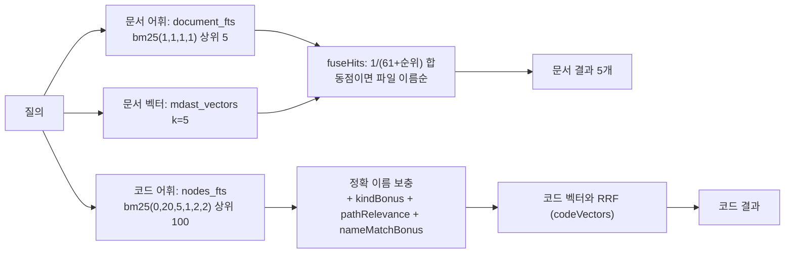

# Try — codegraph CLI 에 Contextual BM25F 적용

> 작성일: 2026-11-06
> 대상 작업: 문서·코드 검색의 어휘 점수(FTS5 `bm25()`)를 Contextual BM25F 로 바꾸면 검색 품질이나 속도가 나아지는지 적대적으로 검수

## 0. 결론 (먼저)

**지금은 도입하지 않는다.** 실측에서 품질 이득이 측정 잡음보다 작고, 속도는 나빠진다.

- 품질: 문서 질문 164개와 코드 질문 40개(문항마다 kw, nl 질의 두 개)를 쟀다. BM25F 는 최종 Hit@1 을 문서 1문항, 코드 kw 0문항, 코드 nl 1문항 바꿨다. 이웃 문맥 필드를 더해도 묶음마다 ±1문항이다. 한 문항은 4.5~10점이다.
- 속도: 어휘 점수 계산은 질의 하나에 0.4~69 ms 다. 질의 시간은 임베딩 모델 로딩(1.3~1.5 s)이 정한다. BM25F 를 JS 로 계산하면 필드 통계를 매 프로세스마다 읽어야 해서 Zyxel 에서 1.5~2.1 s 가 더 든다.
- 실험에서 드러난 더 큰 원인 두 가지:
  - 문서 검색은 어휘 1위와 벡터 1위의 RRF 점수가 같으면 **파일 이름순**으로 1위를 정한다. 원자그래프 44문항 중 12문항은 이 동점 처리가 정답 여부를 정했다. 동점일 때 벡터를 앞세우기만 해도 tune +6, report +7 문항이 맞았다.
  - 코드 kw 질문 중 1위를 놓친 23건에서 12건은 BM25 단계의 상위 5 안에 정답이 이미 있었다. 정답은 BM25 뒤 단계(가점, 정확 이름 보충, 벡터 결합)에서 밀렸다. 그래서 BM25 순위를 바꿔도 최종 순위가 그대로였다.

## 1. 현황 (As-Is)

### 1-A. 어휘 점수가 쓰이는 두 경로

- 문서: `lib/docs/lexical-search.js:14` `searchDocsLexical`, `lib/docs/search.js:63` `searchCandidates`, 결합은 `lexical-search.js:60` `fuseHits`.
- 코드: `lib/db/queries.js:872` `searchNodesFTS`, 가점은 `queries.js:750` 부근, 결합은 `lib/index.js:1024` `searchNodesHybrid`.
- `--limit 5` 이면 문서 어휘와 벡터 후보도 각각 5개다(`search.js:44` 의 `depth`).

### 1-B. FTS5 `bm25()` 는 이미 BM25F 의 절반이다

| 항목 | FTS5 `bm25()` | BM25F (Robertson 외, 2004) | 차이 |
|---|---|---|---|
| 필드 가중 | 열 가중치를 곱한 출현 수를 합친 뒤 포화를 한 번 함 | 같음 | 없음 |
| 길이 정규화 | 행 전체 토큰 수 하나와 `b` 하나 | 필드마다 길이, 평균 길이, `b` | **이것만 다름** |
| IDF | 행 기준 | 행 기준 | 없음 |

근거: 이 식(k1=1.2, b=0.75, 행 전체 길이)을 JS 로 다시 짜서 돌렸다. 실제 SQL 순위와 문서 질문 164/164 의 상위 5, 코드 질문 40/40 의 최종 상위 10 이 같았다. 문서 빈도(nHit)도 1,288개 구에서 모두 같았다.

따라서 "BM25F 적용"으로 새로 바뀌는 것은 필드별 길이 정규화 하나다.

### 1-C. "작은 청크" 전제

- Contextual BM25F 의 출발점은 RAG 에서 청크가 작으면 BM25 가 약해진다는 문제다(긱뉴스 요약).
- codegraph 문서 색인은 청크가 없다. 파일 하나가 `document_fts` 의 행 하나다. `structure` 열은 임베딩 입력을 최대 20,000자까지 넣는다(`document-store.js:88`).
- 행 하나의 평균 글자 수(4개 열 합)는 BLADE 1.2k, Zyxel 2.1k, 원자그래프 1.7k, Arcyn 6.6k 다. 원자 노트는 작아서 전제와 비슷하다. 그래서 이웃 문맥 필드 실험(C0~C2)은 원자그래프에서 의미가 있다.

### 1-D. 이미 한 측정 (안 A sweep, 2026-11-03)

- `docsFtsWeights` 를 `[1,1,1,1]`, `[1,4,2,1]`, `[2,4,2,1]` 로 바꿔 36조합을 쟀다. `[1,4,2,1]` 과 `[2,4,2,1]` 은 12쌍 모두 Hit@1 이 같았다(9쌍은 모든 지표가 같음). 경로 열 가중치는 효과가 없었다. 고르는 규칙(Hit@5 유지, tune 평균 Hit@1 최대)으로 고르니 기본값 `[1,1,1,1]` 이 남았다.
- `docsLexicalWeightHangul` 을 0.5 로 낮추면 원자그래프 report Hit@1 이 9.09 → 36.36 으로 올랐다. 그러나 BLADE Hit@5 가 100 → 93.33 으로 내려가 기각됐다.
- 즉 열 가중치(필드 가중)는 이미 쟀고 효과가 없었다. 효과가 컸던 것은 어휘 쪽 비중, 곧 결합 방식이었다.

## 2. 제안 구조 (To-Be)와 실험한 변형

### 2-A. "Contextual BM25F" 의 뜻

Sionic AI 원문(2025-04-30) 본문은 자바스크립트로 그려져 읽지 못했다. 확인한 것은 긱뉴스 요약의 "주변 청크의 문맥을 가중치로 반영" 한 줄뿐이다. 그래서 공개된 두 개념으로 나눠 실험했다.

| 해석 | 내용 | 실험 |
|---|---|---|
| BM25F | 필드마다 길이 정규화를 한 뒤 가중합하고 포화를 한 번 함 | F1, F2 |
| 이웃 문맥 필드 | 문서가 거는 링크와 문서로 오는 링크의 제목(최대 40개)을 5번째 필드로 넣음 | C0, C1, C2 |
| Anthropic Contextual BM25 | LLM 이 청크마다 50~100토큰 설명을 만들어 앞에 붙인 뒤 색인 | 하지 않음. 문서마다 LLM 호출이 필요함(Zyxel 9,929회). 오프라인 CLI 와 맞지 않음 |

### 2-B. 실험 방법

1. 다섯 프로젝트의 `codegraph.db` 를 복사해 읽기 전용으로 열었다. 원본은 건드리지 않았다.
2. 질문과 정답은 search-eval 과 같다(문서 4묶음 164문항, 코드 2묶음 각 20문항). tune/report 나눔도 같다.
3. 문서: 벡터 상위 5 는 제품 `docs-batch` 에서 받고, 어휘 상위 5 만 변형마다 바꿔 제품과 같은 `fuseHits` 식으로 합쳤다. 변형 없이 합친 결과가 제품 출력과 164/164 같았다.
4. 코드: 제품의 `QueryBuilder.prototype.searchNodesFTS` 점수만 바꿔 끼우고 `searchNodesHybrid`, `findRelevantContext` 를 끝까지 돌렸다. 일치 집합은 FTS5 그대로다. 재현 변형(V0r)이 제품과 40/40 같았다.
5. 스크립트와 결과: `D:/Fork/.AI/context/search-eval/try-bm25f/` (`docs-exp.cjs`, `code-exp.cjs`, `docs-exp.json`, `code-*.json`, 반영 확인용 `verify-tie.cjs`). 스크립트는 같은 폴더의 `proj/<묶음>/.codegraph/codegraph.db` 복사본을 읽는다. 복사본은 지웠으므로 다시 돌릴 때는 다섯 DB 를 그 자리에 먼저 복사한다.

## 3. 장단점 비교

### 3-0. 측정 결과

문서, 결합 뒤 Hit@1 (tune / report). 문항 수는 BLADE 15/15, Zyxel 15/15, 원자 22/22, Arcyn 문서 20/40.

| 변형 | BLADE | Zyxel | 원자 | Arcyn 문서 | 바뀐 문항(tune, report) |
|---|---|---|---|---|---|
| V0 (지금) | 80 / 93.3 | 53.3 / 40 | 22.7 / 9.1 | 55 / 45 | 기준 |
| F1 BM25F | 80 / 93.3 | 53.3 / 40 | 22.7 / 13.6 | 55 / 45 | 0, +1 |
| F2 BM25F, 제목 4·요약 2 | 80 / 93.3 | 53.3 / 40 | 22.7 / 9.1 | 55 / 45 | 0, 0 |
| C0 FTS5 + 이웃 문맥 | 80 / 93.3 | 53.3 / 46.7 | 27.3 / 13.6 | 55 / 42.5 | +1, +1 |
| C1 BM25F + 이웃 문맥 1 | 80 / 93.3 | 53.3 / 40 | 27.3 / 13.6 | 55 / 45 | +1, +1 |
| C2 BM25F + 이웃 문맥 0.5 | 80 / 93.3 | 53.3 / 46.7 | 27.3 / 13.6 | 55 / 45 | +1, +2 |
| V0-tieVec (동점이면 벡터 먼저) | 86.7 / 93.3 | 46.7 / 46.7 | 50 / 31.8 | 55 / 47.5 | **+6, +7** |
| V0-lex0.5 (어휘 비중 절반) | 80 / 93.3 | 46.7 / 60 | 50 / 31.8 | 60 / 47.5 | +6, +9 |
| 벡터만 | 86.7 / 86.7 | 40 / 46.7 | 50 / 36.4 | 60 / 50 | 참고 |

- Hit@5 는 V0-tieVec 가 모든 묶음에서 V0 이상이다(원자 report 77.3 → 86.4, Arcyn report 67.5 → 72.5). V0-lex0.5 는 BLADE report Hit@5 가 100 → 93.3, Arcyn tune 85 → 80 으로 내려간다.
- V0 에서 결합 1위가 동점인 질문: BLADE 2/30, Zyxel 12/30, 원자 29/44, Arcyn 17/60. 그중 동점 처리가 정답 여부를 가른 질문: 1, 6, 12, 5.
- 어휘만의 Hit@1(V0): BLADE 66.7/100, Zyxel 33.3/20, 원자 9.1/9.1, Arcyn 45/35. 어휘 상위 50 안에 정답이 있는 질문: 27/30, 25/30, 27/44, 51/60. 원자그래프는 17문항의 정답이 어휘 상위 50 에도 없다. 점수식을 바꿔도 이 17문항은 어휘 상위 5 에 들 수 없다. 원인은 토큰화로 보인다(`unicode61` 은 조사 붙은 어절을 한 토큰으로 둠).

코드, 최종 순위.

| 묶음 | 변형 | kw Hit@1 | kw Hit@5 | nl Hit@1 | FTS 단계 Hit@1 | FTS 상위 10 이 V0 와 다른 질문 |
|---|---|---|---|---|---|---|
| rx1 | V0 | 40 / 40 | 80 / 50 | 10 / 0 | 40 / 60 | - |
| rx1 | F1 | 40 / 40 | 80 / 50 | 10 / 0 | 50 / 60 | 13/20 |
| Arcyn | V0 | 50 / 40 | 70 / 60 | 10 / 0 | 20 / 30 | - |
| Arcyn | F1 | 50 / 40 | 70 / 60 | 10 / 10 | 20 / 30 | 9/20 |

- 질문별 최종 kw 순위는 40문항 모두 V0 와 F1 이 같았다. FTS 단계 순위는 크게 움직였다(Arcyn a01 18위 → 1위, a07 1위 → 40위, a11 90위 → 5위).
- 1위를 놓친 kw 23건(rx1 12, Arcyn 11) 중 12건은 FTS 단계 상위 5 안에 정답이 있었다. 5건은 FTS 단계 1위였다(rx1 r02, r09, r12, Arcyn a07, a08).
- rx1 의 실제 DB 에는 코드 벡터 표가 없어 rx1 은 벡터 없이 쟀다. Arcyn 은 벡터 22,418개로 쟀다.

속도 (중앙값).

| 묶음 | FTS5 SQL | JS 구 일치 계산 + BM25F 점수 | JS 필드 통계 적재 (프로세스마다) |
|---|---|---|---|
| BLADE | 1.69 ms | 0.11 + 0.12 ms | 0.19 s |
| Zyxel | 69.2 ms | 4.35 + 6.4 ms | 2.1 s |
| 원자 | 0.39 ms | 0.04 + 0.02 ms | 0.09 s |
| Arcyn 문서 | 0.65 ms | 0.06 + 0.02 ms | 0.24 s |

값은 `try-bm25f/docs-exp.json` 의 마지막 실행이다. 세 번 돌린 Zyxel 적재 시간은 1.5, 1.8, 2.1 s 였다. CLI 는 상주 프로세스가 없다(데몬 금지). 그래서 JS 방식은 질의마다 적재 비용을 낸다.

### 3-A. 아키텍처 명확성

- 지금: 토큰화, 일치, 점수가 모두 FTS5 하나에 있다. 점수의 정본이 한 곳이다.
- BM25F 를 넣는 방법은 셋이고, 모두 정본이 둘로 갈린다.
  1. JS 재계산: FTS5 로 일치 집합만 받고 필드별 길이와 출현 수를 JS 에서 셈. JS 토큰화가 `unicode61` 과 어긋나면 조용히 틀린다. 이번 실험은 맞췄지만 SQLite 판이 바뀌면 다시 확인해야 한다.
  2. 필드별 FTS5 표: 열마다 FTS5 표를 따로 둠. 길이 정규화는 필드별이 되지만 포화가 필드마다 따로라 BM25F 가 아니라 "필드별 BM25 합"이 된다.
  3. 네이티브 확장: C 로 `bm25f()` 보조 함수를 만들어 sqlite-vec 처럼 불러옴. `node:sqlite` 에는 FTS5 보조 함수를 JS 로 등록하는 API 가 없다.
- 이웃 문맥 필드는 문서 링크 그래프(`doc_links`)에 어휘 색인이 의존하게 만든다. 링크가 바뀌면 이웃 문서의 FTS 행도 다시 써야 한다.

### 3-B. 컴파일·빌드 영향 (색인, 이주, 배포)

- JS 재계산: 스키마 변경은 없다. 질의 시간만 는다(Zyxel +1.5~2.1 s).
- 필드 통계를 DB 에 저장: `document_fts` 와 `nodes_fts` 옆에 필드별 길이·출현 수 표가 필요하다. 이주 하나와 모든 그래프 재색인이 따른다.
- 이웃 문맥 필드: `document_fts` 에 열을 더하는 이주와 문서 그래프 다섯 곳 재색인. 링크 하나가 바뀌면 이웃 문서 수만큼 FTS 행을 다시 써야 해서 sync 시간이 는다(묶음 1, 2 로 줄인 시간과 충돌).
- 네이티브 확장: 플랫폼별 바이너리를 빌드하고 배포 zip 에 넣어야 한다. sqlite-vec 와 같은 부담이 하나 더 생긴다.

### 3-C. 현재 작업과의 연관성

- 안 C 가 같은 자리를 이미 고친다.
  - D3b: `document_fts` 에 한글 2-gram 열과 열 비중(`docsGramsWeight`)을 더함. 원자그래프 어휘 실패의 원인(토큰화)을 겨냥한다.
  - D5: 긴 문서의 조각 벡터. "작은 청크" 문제의 반대편(긴 문서 뒷부분)을 벡터 쪽에서 다룬다.
- 안 C 를 실행하면 `document_fts` 열이 바뀌어 이번 측정의 기준이 달라진다. BM25F 를 따로 넣으면 안 C 와 같은 파일(`lexical-search.js`, `indexer.js`, `document-store.js`)을 고친다.
- 동점 처리 문제는 안 C 의 측정에도 섞인다. 안 C 10단계의 Hit@1 차이 일부는 2-gram 효과가 아니라 동점이 바뀐 효과일 수 있다.

### 3-D. 단기 비용 (이전 위험)

- 구현: JS 재계산만 해도 문서·코드 두 경로의 점수 함수, 필드 통계 적재, 시험이 필요하다. 플랜 기준 중형(파일 4~6개)이다.
- 재측정: 지금 질문 세트로는 이득을 증명할 수 없다. 1문항이 4.5~10점이라 +1문항은 잡음과 구별되지 않는다. 같은 설정인데 11-03 기준선과 오늘 V0 가 두 묶음에서 1문항씩 다르다(BLADE tune 73.33 → 80, Zyxel report 46.67 → 40). 그 사이 색인과 모델이 바뀌었기 때문으로 본다.
- 과적합: BM25F 는 필드마다 `b` 와 가중치가 있어 문서 4~5필드면 조정값이 9~11개다. split 하나에 15~22문항으로는 맞출 수 없다.

### 3-E. 장기 유지보수

- 지금 구조는 FTS5 가 점수를 소유하므로 SQLite 판 올림만 따라가면 된다.
- BM25F 를 넣으면 점수식, 필드 통계, 토큰화 재현을 직접 유지해야 한다. 이번 실험에서 쓴 `unicode61` 재현도 라틴 발음 구별 기호 처리 같은 근사가 들어 있다.
- 이웃 문맥 필드는 링크 그래프와 어휘 색인 사이에 갱신 순서 의존을 만든다. 신선도 문제를 디버깅할 대상이 하나 는다.

## 4. 순환 의존성·방향 위험 분석

- 결합 방식이 어휘 개선을 가린다. 문서 결합은 순위만 쓰는 RRF 이고 후보가 5개뿐이다. 어휘 점수를 바꿔도 Hit@1 에 닿는 길은 둘뿐이다. 하나는 새 어휘 1위가 벡터 상위 5 에도 있는 경우, 다른 하나는 동점 처리가 바뀌는 경우다. 그래서 동점 처리를 고치기 전에는 어휘 점수 개선을 공정하게 잴 수 없다.
- 원자그래프에서는 어휘 쪽이 지금 손해다. 벡터만 쓰면 50 / 36.4, 지금 결합은 22.7 / 9.1 이다. 어휘 점수를 다듬어도 토큰화가 그대로면 17문항은 어휘로 잡히지 않는다.
- 코드는 BM25 다음 단계가 순위를 정한다. `nameMatchBonus`(정확 30, 접두 20), 정확 이름 보충, 벡터 RRF 가 BM25 점수보다 크다. BM25F 의 효과가 이 단계에서 지워진다.
- 범위 밖 발견(보고만 함): 복사본 DB 에 메타데이터 없는 고아 행이 있다.
  - BLADE: `document_fts` 9행, 문서 벡터 70개(1,439개 중).
  - rx1: `document_fts` 81행, 문서 벡터 30개(163개 중).
  - 고아 벡터가 `k=5` 자리를 차지해 BLADE 일부 질문은 벡터 후보가 4개만 돌아온다. 지금의 `removeDocuments`(`document-store.js:66`)는 FTS 와 벡터를 함께 지우므로, 고아 행이 생긴 경로는 확인하지 않았다.

## 5. 종합 평가 및 추천

**판정: 반대.** 지금 codegraph CLI 에 Contextual BM25F 를 넣어도 품질은 측정 잡음 안에서만 움직이고, 속도는 나빠지며, 안 C 와 같은 파일을 고친다.

대신 다음 순서를 권한다.

1. 문서 결합의 동점 처리를 고친다. 동점이면 벡터 쪽을 먼저 둔다. `fuseHits` 한 곳이고 조정값이 없다. 이번 실측에서 tune +6, report +7 문항, Hit@5 는 모든 묶음에서 같거나 올랐다. 안 C 기준선(1단계)을 재기 전에 하는 것이 맞다. 그래야 안 C 의 효과가 동점 효과와 섞이지 않는다.
   - 2026-11-06 반영(KIT 소스만): `lib/docs/lexical-search.js` 의 `fuseHits` 가 동점에 파일 이름순을 쓰지 않고, 넣은 순서(벡터 순위, 그다음 어휘 순위)를 안정 정렬로 유지한다. 시험은 `test/search-tuning.test.cjs` 의 두 시험이다.
   - 고친 소스로 제품 `docs-batch` 를 다시 돌렸다. Hit@1, Hit@5, MRR 이 네 묶음 모두 V0-tieVec 행과 같았다. Zyxel tune Hit@1 은 53.3 → 46.7 로 1문항 내려갔다.
   - 2026-11-06 15:14 배포: 안 A 10단계 절차로 빌드·전역 설치·이 저장소 사본 동기화를 했다. 전역 codegraph 는 `1.1.2-0ceb2eb54fce` 이고, 임베딩 manifest `f7e8d972…` 와 리랭커 manifest `06baca28…` 는 그대로다.
2. 안 C 를 그대로 진행한다. 한국어 어휘 실패의 원인은 점수식이 아니라 토큰화이고, D3b 가 그것을 겨냥한다.
3. 코드 검색은 BM25 뒤 단계를 조사한다. FTS 단계 상위 5 에 있던 정답 12건이 어디서 밀리는지(가점, 정확 이름 보충, 벡터 RRF) 질문별로 본다.
4. BLADE·rx1 의 고아 행이 생긴 경로를 조사하고 정리한다.

다시 검토할 조건(셋 다 맞을 때):

- 문서 어휘 색인이 파일 단위에서 청크 단위로 바뀐다.
- 질문 세트가 split 하나에 50문항 이상이 된다.
- 결합의 동점 처리를 고친 뒤에도 어휘 쪽 실패 중 "정답이 상위 50 안에는 있으나 5 밖"인 비율이 높다.

그때는 F1 과 C2 만 다시 잰다. 이번 스크립트를 그대로 쓸 수 있다.

## 6. 미결 사항 연계

- 안 C(`main-2026-11-03-codegraph-search-c`)는 EXECUTE 대기다. 사용자가 추천 1(동점 처리)을 안 C 앞에 따로 하기로 정했고(2026-11-06), KIT 소스에 반영했다. 안 C 의 "변경 전" 문구(4a `require` 줄, 4b `bm25` 줄, 4c `toFtsQuery`, 8a·8b `search.js`)는 `fuseHits` 본문과 겹치지 않는다. 안 C 1단계 기준선은 이 수정이 들어간 소스로 잰다.
- Sionic 원문의 정의와 실험 수치는 확인하지 못했다. 원문 본문을 구하면 2-A 표의 해석을 다시 맞춘다.
- 측정 질문 수가 작다. Hit@1 의 1문항 변화는 이번 문서 전체에서 결론 근거로 쓰지 않았다.

## 출처

- 긱뉴스 요약: https://news.hada.io/topic?id=20765
- Sionic AI 원문(본문 미확인): https://blog.sionic.ai/introducing-contextual-bm25f
- Anthropic, Contextual Retrieval: https://www.anthropic.com/news/contextual-retrieval
- BM25F 필드별 길이 설정 설명(Alibaba Cloud OpenSearch): https://help.aliyun.com/en/open-search/industry-algorithm-edition/bm25f
- SQLite FTS5 `bm25()` 함수: https://www.sqlite.org/fts5.html#the_bm25_function

## 라벨

- V0: 지금 제품 그대로. 출처는 이 문서 2-B. 실제 FTS5 SQL 순위를 그대로 씀.
- V0r: V0 의 점수식을 JS 로 다시 짠 재현 변형. 출처는 2-B. 재현이 맞는지 확인하는 대조군임.
- F1, F2: BM25F 변형. 출처는 2-A 표. F1 은 열 가중치 1,1,1,1, F2 는 경로 1, 제목 4, 요약 2, 본문 1 이고 둘 다 필드마다 길이로 정규화함.
- C0, C1, C2: 이웃 문맥 필드를 더한 변형. 출처는 2-A 표. C0 은 FTS5 식에 필드만 더함, C1 은 BM25F 에 비중 1, C2 는 BM25F 에 비중 0.5 로 더함.
- V0-tieVec, V0-lex0.5: 어휘 점수는 V0 그대로 두고 결합만 바꾼 비교 변형. 출처는 3-0 표. 앞의 것은 동점이면 벡터를 앞세우고, 뒤의 것은 어휘 쪽 RRF 비중을 절반으로 함.
- 안 A, 안 C, D3b, D5: 검색 개선 묶음과 그 안의 설계 항목. 출처는 `.claude/memory-bank/main/plans/main-2026-11-03-codegraph-structure-innovate.md` 3.3절과 4절, 플랜은 `main-2026-11-03-codegraph-search-c.md`.
- 묶음 1, 2: sync 속도 개선 작업. 출처는 `.claude/memory-bank/main/plans/main-2026-11-04-codegraph-sync-speed-innovate.md` 10절.
- G1: 플랜과 수락 기준의 사람 승인. 출처는 `CLAUDE.md` RULE-3.
- tune, report: search-eval 의 질문 나눔. 출처는 `D:/Fork/.AI/context/search-eval/run.cjs` 의 `halves` 와 `pipeQueries`. tune 으로 고르고 report 로 확인함.
