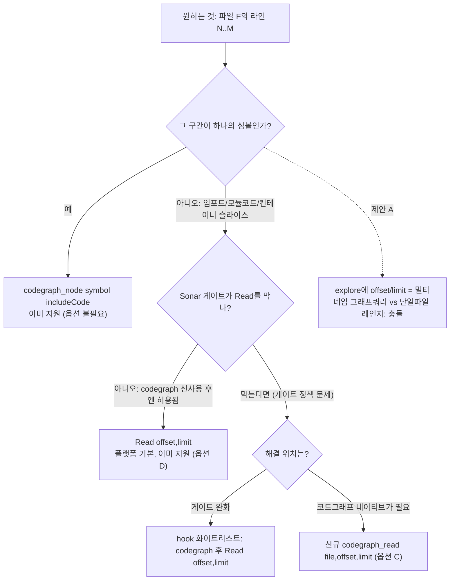

# Try — codegraph_explore 에 n줄 scope read(offset/limit) 추가

> 작성일: 2026-07-14
> 대상 작업: `codegraph_explore`에 `offset: 15, limit: 25` 형태의 라인-윈도우 읽기 기능 추가 검토 + 적대적 대안 검증

## 0. 요청 해석 (먼저 명확히)

요청: "explore에 `offset:15 limit:25` 같이 n줄 scope read가 가능하도록."

이 문구의 자연스러운 해석은 **파일의 특정 라인 구간(라인 15부터 25줄)을 읽는 윈도우 read**다. 하지만 이 해석 자체에 이미 설계 문제가 들어있다. `offset`의 기준이 불명확하다.

- 파일 시작(1행)으로부터의 offset인가?
- explore가 고른 각 심볼 span 내부의 offset인가?
- explore query가 여러 파일로 해석될 때(예: `"AuthService loginUser session.ts"` → 5개 파일) 그 offset/limit은 **어느 파일**에 적용되는가?

이 모호성이 3장 적대적 분석의 출발점이다. 부차 해석(결과 페이지네이션)은 3-F에서 별도로 다룬다.

## 1. 현황 (As-Is)

### 1-A. 두 도구의 현재 시그니처 (검증: src/mcp/tools.ts)

| 도구 | 파라미터 | 소스 반환 방식 | 앵커 |
|------|----------|----------------|------|
| `codegraph_explore` | `query`(멀티-네임 bag), `maxFiles`(기본12·clamp 1~20), `projectPath` | 그래프 관련성으로 **여러 파일** 선별 → 적응형 스켈레톤화 → ~35k자 캡 | tools.ts:584 스키마, 2515 handleExplore, 2531 maxFiles |
| `codegraph_node` | `symbol`, `includeCode`(bool), `projectPath` | **단일 심볼**의 verbatim body (컨테이너는 outline) | tools.ts:564 스키마, 3315 handleNode, 3331 includeCode |
| `Read` (플랫폼 기본) | `file_path`, `offset`, `limit` | **단일 파일**의 결정적 라인-윈도우 | 하네스 내장 |

### 1-B. explore 내부 동작 (handleExplore, tools.ts:2515~)

1. `findRelevantContext(query)` — search(8) + 그래프 traversal(depth 3, maxNodes 200)로 subgraph 구성.
2. glue 노드 — named 심볼을 잇는 caller/callee를 subgraph 파일 범위 내에서만 흡수(GLUE_NODE_CAP 60).
3. 적응형 사이징 — spine 파일은 full, off-spine 파일은 signature-only 스켈레톤(`CODEGRAPH_ADAPTIVE_EXPLORE`, tools.ts:271).
4. 파일별로 `readFileSync(abs).split('\n')`로 **디스크 원본을 그대로** 읽어 심볼 span 기준으로 잘라 line-number prefix(tools.ts:255, 2859) 후 방출. `maxFiles` + ~35k자로 캡.

핵심: explore의 입력은 "무엇이 관련 있는가"라는 **의미(semantic) 질의**이고, 출력 선별은 **그래프 랭킹**이 한다. 라인 좌표는 입력이 아니라 출력의 부산물이다.

### 1-C. 현황의 실제 gap (요청이 가리키는 결핍)

라인-윈도우로 얻고 싶은 대상은 셋 중 하나다.

1. **하나의 심볼 body** → 이미 `codegraph_node symbol includeCode=true`로 심볼-정확하게 얻는다. 라인 좌표 불필요.
2. **비-심볼 구간**(임포트 블록, 모듈 레벨 코드, 거대 컨테이너의 일부 슬라이스) → node로 주소 지정 불가. explore는 그래프-구동이라 "정확히 라인 15~40"을 결정적으로 주지 않는다. **이것이 유일한 진짜 gap.**
3. 위 2를 그냥 보고 싶을 때 → `Read(offset, limit)`가 정확히 그 일을 한다. 그리고 Sonar/Cave-Man L1 게이트는 "codegraph **미사용** 후 Read"만 차단하므로, **codegraph 선사용 뒤의 `Read(offset,limit)`는 이미 허용**된다.

즉 gap 2조차도 "codegraph_node/explore로 위치 확정 → `Read(offset,limit)`로 윈도우"라는 승인된 체인으로 이미 커버된다.

## 2. 제안 구조 (To-Be) — 옵션 5종

| 옵션 | 내용 | 한 줄 평 |
|------|------|----------|
| **A** (요청안) | `codegraph_explore`에 `offset`/`limit` 추가 | 시그니처 패러다임 충돌 |
| **B** | `codegraph_node`에 `offset`/`limit`(심볼 body 내부 윈도우) | 정합성은 낫지만 저가치 |
| **C** | 신규 `codegraph_read(file, offset, limit)` 슬라이스 도구 | 라인-윈도우가 정말 필요하면 이게 정답 |
| **D** | 무변경 + 게이트가 post-codegraph Read를 허용함을 확인/명문화 | 최소비용, 이미 성립 |
| **E** | explore **출력**의 페이지네이션(offset/limit = 결과 페이지) | "n줄"이 아니라 "다음 페이지"라면 이쪽 |

## 3. 장단점 비교 (5축)

### 3-A. 아키텍처 명확성 (레이어 경계·책임 분리)

- **옵션 A**: explore의 책임은 "그래프 관련성 기반 다-심볼 survey + 적응형 사이징"이다. `offset/limit`은 "결정적 단일파일 라인 윈도우"로 **직교하는 패러다임**이다. 한 도구에 섞으면 SRP 위반. 결정적으로, explore query는 **멀티-네임 bag**이라 offset/limit이 어느 파일에 걸리는지 시그니처상 정의 불가(1장 모호성). 스켈레톤화(off-spine signature-only)와도 충돌한다. 라인 15~40을 원했는데 그 파일이 off-spine면 애초에 signature만 나온다.
- **옵션 B**: node는 단일 심볼이라 "이 심볼의 15~25번째 줄"은 정의는 된다. 단 심볼 body는 이미 유계라 하위-윈도우 수요가 낮다.
- **옵션 C**: `file+range` 단일 책임. explore(그래프)·node(심볼)·read(결정적 슬라이스)로 삼분되어 가장 깔끔.
- **옵션 D**: 신규 표면 0. 기존 도구 책임 불변.
- 판정: **A 최하, D≈C 최상.**

### 3-B. 도구 표면·빌드·테스트 영향 (Unity의 컴파일·asmdef 대응 축)

- **옵션 A**: MCP 툴 스키마 1개 변경 + handleExplore 분기 추가. 하지만 explore는 이미 `findRelevantContext`(비싼 그래프 계산)를 돈 뒤 파일을 통째로 읽는데, 거기에 라인 윈도우를 **후단 필터**로 얹으면 "비싼 그래프 랭킹 → 결과를 라인으로 잘라버림"이라 계산 낭비. 회귀 리스크: `adaptive-explore-sizing.test.ts`, `explore-output-budget.test.ts` 재검증 필요.
- **옵션 B**: node 스키마 + handleNode + `getCode` 경로에 슬라이스. 테스트 소규모.
- **옵션 C**: 신규 툴 1개 = 스키마 + 핸들러 + dispatch(tools.ts:1303 인근) + 신규 테스트. 표면 증가 최대지만 격리됨.
- **옵션 D**: 코드 변경 0. hook 화이트리스트 명문화만(문서/설정).
- 판정: **D 최소, A는 "적은 코드로 보이지만 회귀면 넓음", C는 정직하게 격리된 증가.**

### 3-C. 현재 작업과의 연관성 (PLAN-5·릴리즈 맥락)

- 방금 v1.0.0을 main에 병합·범프하고 npm/플러그인 릴리즈 파이프라인을 세운 직후다. explore의 시그니처를 바꾸는 것은 **공개 MCP 계약 변경**이라 릴리즈 노트·문서(site/.../mcp-server.md)·플러그인 사용자에게 전파된다. 반면 옵션 D는 계약 무변경.
- retrieval 무회귀 원칙(이 레포 하우스룰)에 A가 가장 위배 소지(탐색 예산·adaptive 사이징 상호작용).
- 판정: **릴리즈 직후 타이밍상 A는 부적절, D가 안전.**

### 3-D. 단기 비용 (마이그레이션·계약 리스크)

- **옵션 A**: 낮은 구현량이지만 **높은 계약 리스크**. offset/limit 의미를 어떻게 정하든(파일 시작 기준으로 강제 등) explore의 다-파일 특성과 싸운다. 사용자 혼란·오용(멀티 파일에 단일 레인지) 유발.
- **옵션 B**: 낮음.
- **옵션 C**: 중간(신규 툴 1개 풀-사이클).
- **옵션 D**: 최소. hook 규칙 확인 + 문서 한 줄.
- **옵션 E**: explore가 이미 35k 캡 + maxFiles로 사이징하므로 페이지네이션 상태(커서) 도입은 stateless MCP에 상태를 얹는 비용.
- 판정: **D 최저, A는 겉보기보다 높음.**

### 3-E. 장기 유지보수

- **옵션 A**: explore 시그니처에 의미 모호한 파라미터가 영구 잔존 → 신규 기여자·에이전트가 "explore로 라인 읽기"를 오학습. 문서로 계속 방어해야 함.
- **옵션 C**: 삼분 책임이 명확해 온보딩·테스트 격리 유리. 단 `Read`와 기능 중복(플랫폼 도구 재발명)이라는 부채.
- **옵션 D**: 유지보수 표면 불변. "위치는 codegraph, 윈도우는 Read"라는 단일 멘탈모델 유지.
- 판정: **D 최상, A 최하.**

### 3-F. 부차 해석 — 만약 원한 것이 "결과 페이지네이션"이라면 (옵션 E)

"n줄"이 파일 라인이 아니라 "explore가 뱉은 긴 출력의 다음 조각"을 뜻했다면, 그건 windowed-read가 아니라 pagination이다. 이 경우도 A(파일 offset)와는 다른 기능이며, 평가는: explore는 **그래프-랭킹** 출력이라 page 2는 정의상 저관련도다. 다음 페이지가 필요하면 query를 좁히는 게 옳고, 적응형 사이징이 이미 그 목적이다. → 저가치, 비권장. (요청 문구 "n줄"은 라인 해석이 우세하므로 이건 확인용으로만 둔다.)

## 4. 순환 의존성·방향 위험 분석

- 도구 계층은 `ToolHandler` 단일 파사드(tools.ts)에서 `CodeGraph`(src/index.ts) 하위 질의를 호출하는 단방향이다. 어느 옵션도 새 순환을 만들지 않는다.
- 위험 방향은 **의미론적**이다. 옵션 A는 "그래프-구동 선별"과 "좌표-구동 읽기"라는 두 방향의 데이터 흐름을 한 진입점에 합류시켜, 입력 계약이 자기모순(멀티-네임 query + 단일 레인지)에 빠진다. 이것이 코드 순환보다 위험한 **계약 순환**이다.
- 옵션 C/D는 흐름을 분리 유지(explore=그래프, read=좌표)해 방향이 깨끗하다.

## 5. 종합 평가 및 추천

### 결론: 옵션 A(explore에 offset/limit) 반대. 1순위 D, 필요 시 C.

적대적 검증의 핵심 반례 두 가지:

1. **시그니처 충돌**: explore는 멀티-네임 그래프 질의를 받는다. `offset/limit`은 단일 파일에만 의미가 있다. 둘을 한 도구에 두면 "어느 파일의 라인?"이 정의 불가. 이건 구현 난이도가 아니라 **계약의 자기모순**이라 파라미터 문서를 아무리 달아도 해소되지 않는다.
2. **이미 존재하는 경로**: 라인-윈도우가 필요한 실제 상황(비-심볼 구간)은 "codegraph_node/explore로 위치 확정 → `Read(offset,limit)`"로 이미 커버되고, Sonar 게이트도 codegraph 선사용 뒤의 Read를 이미 허용한다. explore를 확장할 게 아니라, **이 승인된 체인이 성립함을 확인·명문화**(옵션 D)하면 신규 표면 0으로 요구가 충족된다.

### 단계별 추천 순서

1. **먼저 옵션 D 확정**: Cave-Man/Sonar hook이 "codegraph 선사용 후 `Read(offset,limit)`"를 실제로 통과시키는지 1건 실측. 통과하면 → 기능 요구는 이미 충족. 스킬/룰에 "라인-윈도우는 codegraph로 위치 확정 후 `Read(offset,limit)`" 한 줄 명문화로 종결.
2. **D로도 부족하다고 판정될 때만 옵션 C**: (근거 예: 게이트를 절대 완화 못 하는 정책, 혹은 cross-project·MCP-only 클라이언트에서 플랫폼 Read가 없는 환경) 그때 `codegraph_read(file, offset, limit)` 신규 툴을 격리 추가. 단 이건 플랫폼 Read의 재발명이라는 부채를 감수하는 결정이므로 명시적 근거 필요.
3. **옵션 A/B/E는 비권장**. A는 계약 모순, B는 저가치, E는 그래프-랭킹 출력에 페이지네이션을 얹는 저효용.

### 착수 경계

이 문서는 분석까지다. `codegraph_read` 신규 툴(옵션 C)이나 hook 명문화(옵션 D) 착수는 사용자 결재 후 별도 진행. 승인 시 옵션 D 실측부터.

## 6. 미결 사항 연계

- **요청 의도 확정 필요**: "n줄 scope read"가 (1)비-심볼 라인 윈도우인지 (2)explore 출력 페이지네이션인지. (1)이면 위 D/C 트랙, (2)면 옵션 E인데 비권장.
- **게이트 실측 1건**: 옵션 D 성립 여부는 hook 동작 실측에 달렸다. 이 값이 전체 추천의 분기점.
- PLAN-5 릴리즈 직후이므로, 어떤 계약 변경(A/C)이든 site 문서(mcp-server.md)·플러그인 매니페스트·CHANGELOG 전파가 딸린다는 점을 착수 시 반영.
