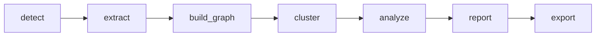

# Graphify vs CodeGraph: 목적 · 효율 · 시사점 비교분석

**작성일**: 2026-07-24
**비교 대상**: [Graphify-Labs/graphify](https://github.com/Graphify-Labs/graphify) (default branch `v8`) vs 이 repo(`D:\Fork\codegraph`, npm `@evespimrose/codegraph`)의 codegraph 엔진(`src/`) + 사용자 커스텀 md 개발분(`.claude/`, `.codex/`)

## 0. 조사 범위와 방법 (실측 vs 추론 구분)

- **graphify**: 로컬에 설치·실행하지 않았다. GitHub API/raw로 소스 트리 전체 파일목록, `ARCHITECTURE.md`, `docs/how-it-works.md`, `graphify/report.py`, `graphify/exporters/html.py`, `graphify/callflow_html.py`, `graphify/tree_html.py`, `worked/httpx/` 예제 산출물(`GRAPH_REPORT.md`, `review.md`)을 정적으로 읽고 분석했다. 아래 graphify 관련 서술은 **소스·문서 기반 정성 추론**이며, 실행 계측이 아니다.
- **이 repo**: `codegraph_status`를 이 repo 자신, `D:\Fork\BLADE`, `D:\Fork\RX_1`에 직접 실행해 얻은 **실측치**를 사용했다. `codegraph_context`/`codegraph_explore`/`codegraph_node`로 `src/` 소스를 직접 확인했다.
- 두 도구를 동일 코퍼스(BLADE, RX_1)에 대해 **동시 실행해 비교한 벤치마크는 아니다.** 2절의 graphify 수치는 graphify 자신이 공개한 파이프라인 비용 모델과 벤치마크(`docs/how-it-works.md`)를 BLADE/RX_1의 실측 구성(파일 수, 코드/문서 비율)에 대입한 추정이다.

## 1. 목적 및 커버 범위

### 1.1 Graphify

일반 코드베이스와 문서/PDF/SQL 스키마/설정을 질의 가능한 지식 그래프로 바꾸는 범용 오픈소스 도구. Claude Code, Cursor, Codex, Gemini CLI 등 위에서 `/graphify` 스킬로 동작하며, 라이브러리 자체는 스킬과 독립적으로도 쓸 수 있다.

- **구현**: Python 3.10+, `uv tool install graphifyy` 배포, `pyproject.toml` + `uv.lock`
- **파이프라인** (`ARCHITECTURE.md`):

  - Pass 1 코드: tree-sitter 파싱, 로컬·무료. 코드 전용 코퍼스면 Pass 3는 아예 스킵된다.
  - Pass 2 영상/음성: `faster-whisper` 로컬 전사, 무료. god node로 프롬프트를 시딩한다.
  - Pass 3 문서/논문/이미지: Claude subagent 병렬 실행, **토큰 비용 발생**. 문서·PDF·이미지·전사본만 대상.
- **언어/포맷 커버리지**: `graphify/extractors/`에 30개 이상의 개별 추출기(Python/TS/JS/Go/Rust/Java/C/C++/Ruby/C#/Kotlin/Scala/PHP/Swift/Lua/Zig/PowerShell/Elixir/Julia/Fortran/Pascal/Dart/Apex 등) + SQL(테이블/FK/JOIN 결정론적 추출)/Terraform-HCL/Bash/JSON/XAML/Razor/`.sln`(Visual Studio 솔루션)/DreamMaker(`.dm`). 추가로 SCIP ingest, MCP ingest, Google Workspace(`.gdoc`/`.gsheet`/`.gslides`, opt-in), Postgres introspection, Cargo workspace introspection까지 인입 경로를 넓힌다.
- **그래프 강화**: Leiden 알고리즘 커뮤니티 탐지(`cluster.py`, 임베딩 불요 — Claude가 추출한 `semantically_similar_to` 엣지가 구조 자체에 반영됨), god-node/betweenness 중심성 분석과 "의외의 연결" 탐지(`analyze.py`), 모든 관계에 `EXTRACTED`/`INFERRED`(0.55~0.95 이산 신뢰도)/`AMBIGUOUS` 3단계 라벨링.
- **산출물**: `graph.json`(NetworkX node-link), `GRAPH_REPORT.md`(god node·커뮤니티·의외의 연결·제안 질문 자동 생성), `graph.html`(대화형 뷰어), 선택적으로 Neo4j/FalkorDB/GraphML/SVG/Obsidian vault export.
- **배포**: `tools/skillgen/`(공용 fragments + `platforms.toml` + `gen.py`) 템플릿 엔진으로 16종 AI 툴(agents/amp/claude/claw/codex/copilot/devin/droid/kilo/kiro/opencode/pi/trae/vscode/windows/aider)용 skill 파일을 자동 생성. `tools/skillgen/expected/`에 골든파일 대조 테스트 존재.
- **성숙도**: MIT/Apache-2.0 dual license, 생성 2026-04-03 / 최근 push 2026-07-22, `tests/` 약 150개 파일(언어별 import resolution, cross-file/cross-language 호출 해석, 증분 업데이트, LLM 백엔드별 목킹까지 포괄), README 30개 언어 번역.

### 1.2 이 repo — codegraph 엔진 (원본, `src/`)

같은 계열의 범용 코드 지식그래프 엔진이나, "100% 로컬"을 1차 가치제안으로 내세운다(`README.md`: "~25% cheaper · ~62% fewer tool calls · 100% local"). npm 패키지 `@evespimrose/codegraph`, MIT, `node:sqlite`(FTS5 + WAL) 백엔드.

- **언어 커버리지**: `src/extraction/languages/`의 c-cpp/csharp/dart/go/java/javascript/kotlin/lua/luau/objc/pascal/php/python/ruby/rust/scala/swift/typescript + dfm/liquid/mybatis/svelte/vue 전용 추출기. `src/resolution/frameworks/`에 react/react-native/vue/svelte/express/nestjs/laravel/drupal/django류 python/rails류 ruby/cargo workspace/go module/java/kotlin fabric/swift-objc bridge 등 프레임워크 인식 임포트 해석기.
- **MCP 서버**: 11개 도구(`context`/`search`/`explore`/`node`/`files`/`status`/`callers`/`callees`/`impact`/`trace`/`backlinks`). `trace`는 콜백·재렌더링 등 동적 디스패치 홉까지 단일 호출로 반환하는 것을 지향점으로 삼는다.
- **문서 인덱싱**: mdast 파싱 + FTS5(어휘 검색) + sqlite-vec(`@xenova/transformers` 로컬 임베딩, optionalDependency)로 시맨틱 검색을 제공한다. `src/docs/search.ts`/`indexer.ts` 확인 결과 `embed()`는 로컬 트랜스포머 모델 호출이며 **LLM API 호출이 없다.**
- **배포**: `src/installer/targets/`에 8개 AI 툴(claude/codex/cursor/gemini/hermes/kiro/opencode/antigravity) 설치기.
- **테스트**: `__tests__/` 66개 파일 + `__tests__/evaluation/`(자체 벤치마크 러너, `/agent-eval` 스킬과 연계).
- **그래프 강화 기능 없음**: 커뮤니티 탐지, god-node/centrality 분석, 표준화된 신뢰도 태깅, 자동 내러티브 리포트가 없다. 전부 질의형(pull) MCP 도구로만 노출된다.

### 1.3 이 repo — 커스텀 md 개발분 (`.claude/`, `.codex/`)

graphify와는 종류가 다른 산출물이다. graphify가 "제품"이라면 이쪽은 codegraph 엔진을 코드 인텔리전스 백엔드로 쓰는 특정 사용자(evespimrose)의 유니티 게임개발 운영 하네스다.

- **3-Tier 멀티에이전트 스튜디오**: Tier1 Opus(`producer`/`creative-director`/`technical-director`, 의사결정) · Tier2 Sonnet(`lead-programmer`/`unity-specialist`, 구현총괄) · Tier3 Sonnet(`quality-sentinel`/`reporter`/`writer`/도메인전문가, 실행·검증).
- **거버넌스 장치**: RIPER-5 워크플로 상태 추적(`.claude/memory-bank/.riper-state`), BLK 공간좌표 PRD 표기(RULE-4), Sonar Protocol(코드그래프 우선 사용을 강제하는 PreToolUse 훅), Output-Arm/Strict-Arm 토큰경제 정책, state-doctor 파생상태 신뢰도 게이트.
- **엔진과 하네스의 결합 지점**: 완전히 분리되어 있지 않다. `src/docs/indexer.ts`의 `GOVERNED_DIRS = ['cxt/', 'docs/contextmd/', 'manage/']`는 이 하네스의 관례(cxt 파일, L4 dictionary)가 엔진 소스에 하드코딩된 지점이다. 이 디렉토리에 속한 마크다운만 BLK 태그 기반 `concept` 노드가 생성된다 — 3.2/3.3절 수치 차이의 원인.
- **배포**: `sync` 스킬(파일 그대로 복사, 템플릿·코드생성 없음)로 BLADE/RX_1/WIKI/Western-Salon/Hercules/`.PRODUCT` 등 자매 저장소에 스캐폴딩을 전파한다.
- **범위**: 특정 사용자의 특정 멀티 저장소 워크플로에 특화되어 있다. 라이선스 고지, 번역, 공개 벤치마크 문서가 없는 비공개 운영 도구다.

### 1.4 커버리지 요약

| 항목 | Graphify | codegraph 엔진(이 repo) |
|---|---|---|
| 구현 언어 | Python 3.10+ | TypeScript (Node ≥20) |
| 비-코드 인입 | SQL/Terraform/Google Workspace/Postgres/SCIP/영상·이미지(LLM vision) | Markdown(mdast)만 |
| 커뮤니티 탐지 | Leiden 알고리즘 | 미지원 |
| 신뢰도 태깅 | EXTRACTED/INFERRED(0.55~0.95)/AMBIGUOUS | `provenance` 필드(비표준, 미노출) |
| 문서 시맨틱 검색 비용 | LLM subagent (Pass 3, 유료) | 로컬 임베딩 (`@xenova/transformers`, 무료) |
| AI 툴 설치 대상 | 16종 (템플릿 자동생성) | 8종 (수동 유지 installer 클래스) |
| 그래프 DB 익스포트 | Neo4j/FalkorDB/GraphML/SVG/Obsidian | 미지원 (SQLite 단일 저장) |
| 자동 내러티브 리포트 | `GRAPH_REPORT.md` | 미지원 (질의형 도구만) |
| 테스트 파일 수 | 약 150 | 66 |
| 라이선스 | MIT/Apache-2.0 dual | MIT |
| 멀티에이전트 운영 하네스 | 없음 (순수 라이브러리 + 스킬) | 있음 (`.claude`/`.codex` 3-Tier 스튜디오) |

## 2. 상황별 효율 비교

### 2.1 BLADE — 순수 마크다운 볼트 (`D:\Fork\BLADE`)

**실측 (codegraph)**: 파일 1347개 전량 마크다운(코드 파일 0), 노드 1347(전부 `kind=doc` — `GOVERNED_DIRS` 미매치로 `concept` 노드 없음), 엣지 2089, DB 19.71MB, WAL. `isPureMarkdownProject()` 자동 감지로 `doc_link` 그래프 승격이 활성화된다. 비용은 FTS5 어휘검색 + sqlite-vec 로컬 임베딩뿐이며, 최초 인덱싱·재인덱싱(SHA1 해시 비교) 모두 LLM API 호출이 0회다.

**graphify 추론**: BLADE는 코드 0 / 문서 1347이므로 `how-it-works.md`의 "코드 전용 코퍼스면 Pass 3 스킵" 조건에 해당하지 않는다. 오히려 정반대로 전량이 Pass 3(Claude subagent, 토큰 비용) 대상이 된다. graphify 자신의 문서가 "Pass 3 = costs tokens"라고 명시하므로, 최초 전체 빌드 시 1347개 파일에 대한 배치별 subagent 호출 비용이 상당할 것으로 추정된다(SHA256 캐시로 이후 증분 비용은 낮아짐). 커뮤니티 탐지는 임베딩 없이 Claude가 추출한 `semantically_similar_to` 엣지에 의존하므로, 이 규모에서는 커뮤니티 탐지 품질 자체가 Pass 3 비용과 직결된다.

**결론**: 이런 대규모 순수 문서 볼트에는 codegraph의 "로컬 임베딩 + 결정론적 backlink 그래프" 조합이 반복 재인덱싱 비용 면에서 뚜렷이 유리하다. 다만 graphify의 Pass 3는 명시적 링크가 없는 문서 간에도 의미적 연결을 추론해 커뮤니티/god-node 분석에 반영한다 — codegraph에는 없는 "링크 없는 문서 간 유사도 발견" 가치를 제공할 수 있다는 뜻이다. 이는 codegraph의 임베딩이 검색 시점 KNN에만 쓰이고 그래프 엣지로 영속화되지 않는다는 차이에서 온다(3.5절 개선안 참조).

### 2.2 RX_1 — 유니티 C# 프로젝트 (`D:\Fork\RX_1`)

**실측 (codegraph)**: 126파일(csharp 122 · javascript 3 · python 1), 노드 2789(class 137 / method 926 / field 863 / property 155 / interface 2 / struct 24 / enum 13 / enum_member 48 / constant 56 / variable 12 / function 9 / import 387), 엣지 5154. `concept` 노드 31개 — 마크다운 8개 중 `GOVERNED_DIRS` 매치분에서 BLK 태그가 생성한 것으로, RX_1이 이 하네스의 관례 일부를 이미 도입했음을 보여준다.

**graphify 추론**: `extractors/csharp.py`로 구조 추출(Pass 1, 무료) 자체는 가능하다. 코드 118개 + 비-코드(md) 8개 혼재 코퍼스이므로 "코드만 있으면 Pass 3 스킵" 규칙에 해당하지 않고, 8개 md 파일만 Pass 3 대상이 되어 비용은 작다. 즉 RX_1 규모에서는 두 도구의 1차 비용구조가 비슷하게 저렴하다 — 코드 비중이 큰 코퍼스에서는 graphify의 "LLM 비용" 리스크가 크게 부각되지 않는다.

**공통 한계**: 유니티 씬(`.unity`), 프리팹(`.prefab`), ScriptableObject(`.asset`)은 `!u!114` 등 커스텀 태그를 쓰는 멀티문서 YAML이다. graphify의 `extractors/`든 이 repo의 `extraction/languages/`든 이 포맷 전용 추출기는 확인되지 않았다(이 repo 자신의 색인에서도 `yaml: 2`로 범용 설정파일 수준에 그친다). 즉 **두 도구 모두** 어떤 프리팹이 어떤 ScriptableObject를 참조하는지의 유니티 고유 오브젝트 그래프는 보지 못하고, C# 스크립트 레이어만 본다. 이 repo는 이 공백을 그래프가 아니라 하네스(1.3절)의 도메인별 에이전트 라우팅(`engine-programmer`/`gameplay-programmer`/`unity-specialist` 등)과 BLK 좌표 PRD 표기로 사람이 메운다 — graphify에는 이런 라우팅 개념 자체가 없다(단일 스킬 구조).

### 2.3 종합

| 프로젝트 | 실측: codegraph | graphify 추론(미실행) |
|---|---|---|
| BLADE (순수 MD, 1347파일) | 로컬 임베딩 + FTS5, LLM 비용 0 | Pass 3 전량 대상, 최초 빌드 토큰비용 유의미 |
| RX_1 (Unity C#, 126파일) | 로컬 tree-sitter, md 8개만 시맨틱 계층 | Pass 1 무료 + md 8개만 Pass 3(비용 작음) |
| 두 프로젝트 공통 | 유니티 YAML 오브젝트그래프 미지원, 하네스가 대신 보완 | 동일하게 미지원, 보완 장치 없음 |

## 3. Graphify에게 배울 점

### 3.1 템플릿 기반 멀티툴 스킬 생성 (`skillgen`)

graphify는 `tools/skillgen/fragments`(공용 조각) + `platforms.toml`(툴별 변수) + `gen.py`로 16종 툴용 skill 파일을 생성하고, `tools/skillgen/expected/`에 골든파일 대조 테스트까지 둔다. 이 repo는 `.claude/agents/*.md`와 `.codex/agents/*.toml`을 사람이 각각 손으로 병행 유지한다(이번 세션 시작 시 git status에 두 세트가 함께 변경된 상태로 잡힌 것이 그 증거). 단일 소스가 없어 드리프트 위험이 있다.

**제안**: fragments + 생성 스크립트 방식을 도입해 한쪽(`.claude/agents/*.md` 또는 공용 fragment)을 소스로 삼고 나머지 포맷을 빌드 산출물로 생성한다. skillgen의 골든파일 테스트 패턴도 함께 채용하면 수동 동기화 누락을 기계적으로 잡을 수 있다.

### 3.2 자동 생성 내러티브 리포트 (`GRAPH_REPORT.md`)

graphify는 god node(연결수 상위), betweenness 기반 "왜 이 노드가 커뮤니티 간 다리 역할을 하는가", 커뮤니티별 cohesion 점수, "확인이 필요한 추론 엣지" 질문까지 자동 생성한다. 이 repo의 MCP 도구는 전부 질의형(pull)이라 "지금 이 프로젝트에서 가장 연결이 많은 심볼"류의 요약을 사람이 먼저 물어야 얻는다.

**제안**: LLM 추론 없이 순수 그래프 통계(연결수, betweenness)만으로도 랭킹은 뽑을 수 있다. `visualize-graph` 옆에 랭킹 스크립트를 추가하고 그 출력을 `docs/output` 관례에 얹으면 낮은 비용으로 push형 요약을 제공할 수 있다.

### 3.3 커뮤니티/클러스터 탐지 (Leiden)

graphify는 그래프 구조만으로(임베딩 불요) Leiden 커뮤니티 분할을 수행하고, 뷰어 레전드에서 커뮤니티 단위로 전체 표시/숨김이 가능하다. 이 repo의 시각화 레전드는 심볼 종류 또는 최상위 디렉토리 단위일 뿐, 연결 밀도 기반 서브시스템 자동 분할이 없다.

**제안**: 이 규모(수백~수천 노드)라면 순수 JS/TS 커뮤니티 탐지 라이브러리(graphology 계열 등)를 `generate-graph.mjs` 전처리 단계에 추가해 노드에 커뮤니티 id를 주입하는 것이 로컬·무료로 가능하다. graphify처럼 LLM 의존 없이 같은 아이디어를 저비용으로 도입할 수 있다.

### 3.4 신뢰도(confidence) 태깅 표준화

graphify는 모든 엣지를 `EXTRACTED`/`INFERRED`(0.55~0.95 이산 점수)/`AMBIGUOUS` 중 하나로 라벨링하고, 리포트의 "확인 필요 질문"이 이 라벨에서 파생된다. 이 repo는 `provenance` 필드가 존재하나(`doc-links-linker.ts`에서 `'heuristic'` 값 확인) 어휘가 표준화·문서화되어 있지 않고 MCP 도구 응답에도 노출되지 않는다.

**제안**: `provenance` 값을 `extracted`/`inferred` 2단계만이라도 표준화하고 `codegraph_callers`/`codegraph_callees` 응답에 노출하면, 호출 관계가 확실한 정적 해석인지 휴리스틱 추정인지 도구 사용자가 바로 판별할 수 있다.

### 3.5 시맨틱 유사도의 그래프 영속화

graphify는 시맨틱 유사도를 그래프 엣지로 영속화해 커뮤니티 형성 자체에 반영한다. 이 repo는 임베딩을 검색 시점 KNN에만 쓰고 엣지로 남기지 않는다(2.1절에서 지적한 차이).

**제안**: LLM 비용 없이 기존 `@xenova/transformers` 임베딩만으로 코사인 유사도 상위 K쌍을 `semantically_related`류 엣지로 materialize하는 옵션을 docs indexer에 추가하면, graphify 핵심 아이디어(구조 + 의미 결합)를 codegraph의 무료 임베딩 경로로 구현할 수 있다.

## 4. HTML 뷰어 적용 방안

### 4.1 이 repo의 현재 뷰어 (`generate-graph.mjs`)

Cytoscape.js + dagre, 단일 정적 HTML. 코드 모드(class/interface/struct/enum 집계, `calls`/`instantiates`/`implements`/`imports`)와 문서 모드(`doc`/`doc_link`, 최상위 디렉토리 색상)를 자동 감지 또는 `--docs` 플래그로 전환한다. 레이아웃 6종(CoSE / 커스텀 "Obsidian" 물리 / Dagre / Grid / Circle / BFS)을 선택할 수 있고, Obsidian 모드는 중심장력·반발력·링크장력·거리를 슬라이더로 실시간 조정할 수 있다 — 이 기능은 graphify 쪽에서 확인되지 않았다. 검색(실시간 필터 + 자동 줌), 클릭 시 파일/라인/시그니처 + 연결 노드 패널, 레전드 종류별 on/off 토글을 갖췄다.

### 4.2 Graphify의 HTML 산출물 3종

- **`graph.html`** (`exporters/html.py`): vis-network(vis.js, unpkg CDN) 기반. 노드 크기 = 연결수(degree), 클릭 검사 패널, 검색박스, 커뮤니티 레전드(체크박스로 커뮤니티 단위 표시/숨김 + 전체선택), 커뮤니티 기준 물리 클러스터링, 신뢰도별 엣지 스타일, 하이퍼엣지(3개 이상 노드 묶음)를 캔버스 오버레이로 볼록껍질 렌더링, `_viz_node_limit()`로 대형 그래프 노드 수 상한.
- **`callflow_html.py`**: Mermaid.js 기반 내러티브 문서. 커뮤니티에서 자동 유도한 "섹션"별로 다이어그램을 나누고(`derive_sections_from_communities`), 엣지를 점수화해 읽기 좋은 부분집합만 그리며(`edge_score`/`preferred_edges`), 확대축소 + 드래그팬 툴바를 내장하고, 중국어/영어 로컬라이즈를 지원하며, `GRAPH_REPORT.md` 본문을 함께 임베드해 "읽는 문서" 형태로 제공한다.
- **`tree_html.py`**: 디렉토리 트리 전용 뷰. 대형 평면 디렉토리를 "+N more" 형태로 접는 축약 로직이 확인된다.

### 4.3 적용 방안

현재 구조에 낮은 비용으로 붙일 수 있는 것부터 우선순위를 매긴다.

1. **노드 크기를 연결수(degree)에 비례**: `aggEdges` 계산 시점에 degree는 이미 구할 수 있어 추가 라이브러리가 필요 없다. 스타일에 `width`/`height`를 degree 매핑으로 바꾸는 것만으로 적용 가능하다. graphify의 가장 직관적인 기능이며 비용이 가장 낮다.
2. **대형 그래프 안전장치**: BLADE급(1300+ 노드) 문서 모드에서 렌더 성능 저하가 우려된다. graphify의 `_viz_node_limit()`처럼 노드 수 상한 초과 시 연결수 상위 N개만 표시하고 "나머지 M개 숨김"을 안내하는 로직을 `--docs` 모드에 추가한다.
3. **커뮤니티 레전드**: 3.3절 클러스터링을 도입하면 레전드를 심볼종류/디렉토리 외에 "커뮤니티" 기준으로도 전환할 수 있는 셀렉트를 추가한다(graphify처럼 체크박스형 다중 토글).
4. **신뢰도 기반 엣지 스타일**: 3.4절 `provenance` 표준화 이후, `inferred`/`heuristic` 엣지를 점선으로 렌더링해 `extracted` 엣지와 시각적으로 구분한다.
5. **Mermaid 내러티브 산출물은 별도 트랙으로**: `callflow_html.py` 같은 "섹션별 요약 문서"는 이 repo의 `docs/output` 관례(RULE-9)와 결이 같다. `generate-graph.mjs`를 확장하기보다, 커뮤니티별로 `codegraph_context`를 순회해 Mermaid flowchart와 핵심 심볼 요약을 `docs/output/*.md`로 뽑는 별도의 소형 스크립트를 신설하는 편이, 기존 스킬이 SKILL.md에 명시한 "정적 HTML 전용" 범위를 침범하지 않는다.
6. **하이퍼엣지 · 별도 트리 HTML**: 이 repo의 데이터 모델(source/target 이진 엣지, `contains` 기반 파일트리)에서 하이퍼엣지·별도 트리 HTML은 스키마 확장이 필요해 비용 대비 이득이 낮다. 우선순위 밖으로 둔다.

## 5. 결론

- **graphify**: 범용 오픈소스 지식그래프 제품. 넓은 인입 범위(영상/이미지/SQL/클라우드 문서)와 LLM 기반 의미해석·커뮤니티 탐지·자동 리포트가 강점이나, 비-코드 콘텐츠에는 실질적 토큰 비용이 따른다.
- **codegraph 엔진(이 repo)**: 로컬·무료를 축으로 한 실용적 엔진. BLADE급 대규모 문서 볼트에서 비용 우위가 뚜렷하다. 그래프 자체의 분석적 부가기능(커뮤니티·신뢰도·자동 리포트)은 graphify 대비 얕다.
- **커스텀 md 하네스**: graphify에는 대응물이 없는, 특정 사용자의 멀티 저장소 유니티 운영체계다. 유니티 오브젝트그래프 공백을 그래프가 아닌 에이전트 라우팅으로 메우는 것이 특징이며, 동시에 두 도구 공통의 한계(2.2절)를 드러내는 지점이기도 하다.
- **우선순위 제안 3가지**: (1) 노드 크기 = degree 스타일링(즉시 적용 가능), (2) `provenance` 2단계 표준화 + 엣지 스타일 반영, (3) 로컬 임베딩 기반 `semantically_related` 엣지 영속화 실험.
