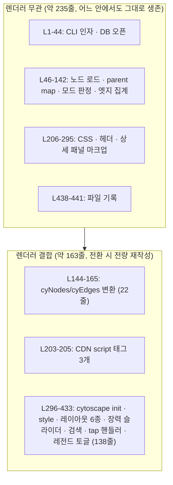

# 05번 플랜 뷰어 라이브러리 3안 비교: 구현 비용 · 런타임 비용 · 유지보수 비용

**작성일**: 2026-07-27
**대상**: [05 HTML 뷰어 플랜](../../.claude/memory-bank/main/plans/2026-07-24-graphify-features-05-html-viewer.md)의 렌더러 선택
**비교 3안**: A) Cytoscape.js 현행 확장 · B) Sigma.js 전환 · C) force-graph 전환
**선행 조사**: [graphify 비교분석](2026-07-24-graphify-vs-codegraph.md), [quarantine/conv1.md](quarantine/conv1.md)

## 0. 측정 기준선

비교의 모든 수치는 아래 두 실측에서 출발한다.

**기준선 1: 현재 뷰어의 계층 구조** (`.claude/skills/visualize-graph/scripts/generate-graph.mjs`, 총 441줄)

전환 비용의 분모는 441줄 전체가 아니라 **결합부 163줄(약 37%)** 이다.

**기준선 2: 실제 렌더 대상 규모** (codegraph_status 실측)

| 프로젝트 | 뷰어가 실제 그리는 노드 수 | 근거 |
|---|---|---|
| BLADE (문서 모드) | **1347 노드 / 2089 엣지** | doc 노드 전량, 이 사용자 저장소 중 최대 |
| 이 repo (코드 모드) | 약 255 노드 | class 55 + interface 111 + struct 89 (집계 후) |
| RX_1 (코드 모드) | 약 176 노드 | class 137 + interface 2 + struct 24 + enum 13 |

즉 **최악 케이스가 1347 노드**다. 이 숫자가 세 프레임 전부의 판정을 좌우한다.

---

## 프레임 1: Claude 토큰 기준 구현 비용

### 산정 모델

토큰 소비는 네 항목의 합이다. 각 항목은 관측 가능한 양에 비례한다.

| 항목 | 비례 대상 | 비고 |
|---|---|---|
| (a) 기존 코드 적재 | 441줄 파일 read | 3안 공통, 약 6K |
| (b) API 학습 | context7 doc fetch 횟수 × 응답 크기 | 이번 조사 1회 질의당 4~8K 실측 |
| (c) 코드 출력 | 작성 줄 수 × 약 12~15 tok/줄 | 밀도 높은 JS 기준 |
| (d) 디버그 반복 | 라운드트립 횟수 × 누적 컨텍스트 | 신규 API일수록 급증, 최대 변수 |

**아래 총량은 추정치이며 실측이 아니다.** (a)(c)는 산술 계산, (b)는 이번 세션 실측 단가 적용, (d)는 신규도 기반 추정이라 오차가 가장 크다.

### 3안 비교

| | A) Cytoscape 확장 | B) Sigma 전환 | C) force-graph 전환 |
|---|---|---|---|
| (a) 코드 적재 | 약 6K (부분 재확인만) | 약 6K | 약 6K |
| (b) API 학습 | **0** (기존 파일이 관용구 전부 보유) | 30~50K (레이아웃 패키지 + 카메라 + reducer + **GLSL 커스텀 엣지 프로그램**) | 10~20K (평면 accessor 목록 1종) |
| (c) 코드 출력 | 약 80줄 신규·변경 → 1~1.5K | 163줄 재작성 + 레이아웃 파이프라인 + GLSL 프로그램 약 250줄 → 3~4K | 163줄 → 약 140줄로 압축 재작성 → 2K |
| (d) 디버그 반복 | 낮음 (Edit 소규모 diff 5회) | **높음** (WebGL 셰이더 실패는 콘솔 오류가 불투명, 좌표계 사전 배치 필수) | 중간 |
| **추정 총량** | **20~40K** | **150~250K** | **60~110K** |

### B안 비용이 튀는 구체적 원인 2가지

두 항목 모두 Sigma 공식 문서에서 확인했다.

1. **점선 엣지가 기본 제공 프로그램에 없다.** Sigma 기본 엣지 프로그램은 `EdgeRectangleProgram` / `EdgeLineProgram`(그리고 타입 `line` / `arrow`)뿐이다. 05번 플랜 5단계(provenance별 점선)를 하려면 `.vert.glsl` + `.frag.glsl` 셰이더 쌍을 포함한 커스텀 엣지 프로그램을 새로 작성해야 한다. A안은 `line-style: dashed` 한 줄, C안은 `linkLineDash(fn)` 한 줄이다.
2. **좌표를 사전 계산해 노드 속성으로 넣어야 한다.** Sigma는 렌더러이지 레이아웃 엔진이 아니다. 공식 예제도 `circlepack.assign()` 또는 수동 각도 배치로 x/y를 먼저 채운 뒤, 별도 패키지 `graphology-layout-forceatlas2/worker`를 붙인다. 게다가 이 패키지 생태계는 번들러 전제라, **CDN script 태그만으로 단일 HTML을 뽑는 현재 아키텍처와 마찰**이 크다.

### 이전 판단 정정: graphology 공유 시너지는 실질 이득이 아니다

직전 턴에서 "03번 플랜이 graphology를 도입하므로 Sigma가 그 객체를 그대로 렌더링해 시너지가 있다"고 했는데, 이는 과대평가였다. 03번 플랜의 Louvain은 **Node 측 빌드 타임**(`src/graph/community.ts`)에서 돌고 결과를 `.codegraph/communities.json`으로 떨군다. 뷰어는 그 JSON을 읽어 HTML에 인라인할 뿐이라 **브라우저는 graphology를 만나지 않는다.** 따라서 공유 이득은 Node 측 변환 약 20줄을 아끼는 수준이며, 위 (b)(d) 비용을 상쇄하지 못한다.

---

## 프레임 2: 런타임 비용

| | A) Cytoscape | B) Sigma | C) force-graph |
|---|---|---|---|
| 렌더링 백엔드 | Canvas 2D | **WebGL** | Canvas 2D (3D 변형은 WebGL/Three.js) |
| 레이아웃 실행 위치 | 메인 스레드 (CoSE 버스트) | **Web Worker** (FA2) | 메인 스레드 (d3-force, 프레임당 증분) |
| 체감 특성 | 레이아웃 중 일시 정지 가능 | 레이아웃이 UI를 막지 않음 | 지속 시뮬레이션이라 버스트 정지 없음 |
| CDN 파일 수 | **3** (cytoscape + dagre + cytoscape-dagre) | 2+ (sigma + graphology UMD, 레이아웃 패키지는 별도) | **1** (d3-force 내장) |
| 공개 대규모 사례 | 소~중규모 대상 | 5000 노드 storybook 데모 | 50만 노드 데모(단 포인터 상호작용 off + decay 튜닝) |
| npm 언팩 크기 | 약 5.7MB | 약 1MB | 미확인 |

`npm 언팩 크기`는 [PkgPulse 2026 비교](https://www.pkgpulse.com/guides/cytoscape-vs-vis-network-vs-sigma-graph-visualization-2026)의 수치이며 **CDN min.js 전송량이 아니다.** 실제 전송량은 측정하지 않았다.

### 판정: 1347 노드에서는 WebGL 이점이 발동하지 않는다

Sigma의 WebGL 우위는 노드 수가 Canvas의 한계를 넘을 때 의미가 생긴다. Sigma 자신의 성능 시연이 5000 노드 규모이고, 이 사용자의 최대 실측치는 **1347 노드**다. 이 구간은 Canvas 2D가 무리 없이 처리하는 영역이라, B안이 지불하는 프레임 1의 비용에 대응하는 런타임 이득이 **현재 데이터에서는 발생하지 않는다.**

다만 A안에는 조건부 리스크가 있다. 05번 플랜 3단계의 노드 상한(기본 800) 안전장치는 정확히 이 Canvas 한계를 전제로 설계된 것이다. C안이나 B안으로 가면 이 상한을 크게 올리거나 제거할 수 있다. 즉 **3단계 안전장치는 A안 선택의 대가**로 보는 것이 정확하다.

CDN 파일 수는 C안이 유일하게 개선한다. 3개 → 1개는 첫 로드 왕복 2회 절감이며, 오프라인/폐쇄망에서 자체 호스팅으로 전환할 때 관리 대상도 줄어든다.

---

## 프레임 3: 유지보수 비용 (추후 기능 확장 포함)

### 기존 기능 유지 가능성 (전환 시 회귀 위험)

| 현재 뷰어 기능 | A) Cytoscape | B) Sigma | C) force-graph |
|---|---|---|---|
| 레이아웃 6종 선택자 (CoSE/Dagre/Grid/Circle/BFS/Obsidian) | 전부 내장 | 외부 패키지 조합, DAG 계층 레이아웃 패키지 존재 여부 미확인 | **`dagMode('td'/'bu'/'lr'/'rl'/'radialout'/'radialin')` 내장** + 공식 예제가 실제 `dagre` 라이브러리를 직접 붙여 `fx`/`fy`로 고정하는 패턴까지 시연(아래 정정 참조). Grid/Circle은 좌표 수동 배치 필요 |
| 장력 슬라이더 4종 (중심/반발/링크장력/거리) | 현행 그대로 | FA2 settings로 매핑 가능 | `d3Force('charge'/'link')` + decay로 매핑 가능, 지속 시뮬레이션이라 반영이 더 자연스러움 |
| 클릭 상세 패널 · 검색 · 레전드 토글 | 현행 그대로 | 재작성 | 재작성 (`onNodeClick` 등 콜백 존재) |

> **정정 (2026-07-27 추가 조사)**: 최초 작성 시 "Dagre 계층 레이아웃 상실이 B·C 공통의 최대 회귀 위험"이라고 썼는데, C(force-graph)에 한해 틀렸다. `force-graph` README에 `dagMode` API가 확인되고, 공식 예제(`example/dagre/index.html`)는 `dagre.graphlib.Graph()`로 실제 dagre 레이아웃을 계산한 뒤 `node.fx = node.x; node.fy = node.y`로 결과를 그대로 고정하는 패턴을 1차 문서로 제공한다 — Cytoscape의 `cytoscape-dagre` 플러그인과 사실상 동급의 통합이 이미 검증된 레퍼런스로 존재한다. **Dagre 상실은 C가 아니라 B(Sigma)에만 해당하는 리스크로 정정한다.** 단, B 쪽도 graphology-layout 계열에 DAG 전용 패키지가 있는지는 이번 조사에서 직접 확인하지 못했다 — "없다"가 아니라 "미확인"이다.

### 향후 확장 항목별 난이도

마스터 플랜 2절의 보류 항목과 05번 플랜 잔여 단계를 대상으로 평가한다.

| 확장 항목 | A) Cytoscape | B) Sigma | C) force-graph |
|---|---|---|---|
| 노드 크기 = degree (05-2) | `mapData` | `size` 속성 | `nodeVal` |
| 커뮤니티 색상 (05-4) | 스타일 셀렉터 | `color` 속성 | `nodeAutoColorBy` 한 줄 |
| **provenance 점선 (05-5)** | `line-style: dashed` | **GLSL 커스텀 프로그램 필요** | `linkLineDash(fn)` |
| 하이퍼엣지 볼록껍질 오버레이 | 별도 canvas 레이어를 pan/zoom과 수동 동기화 (graphify가 vis.js에서 실제로 치른 비용) | 커스텀 WebGL 레이어 또는 DOM 오버레이, 가장 어려움 | **`onRenderFramePre(ctx, scale)` 훅으로 직접 드로잉** |
| 3D 뷰 | 경로 없음 | 경로 없음 | **`3d-force-graph`로 동일 API 계열 이행** |
| 조건부 스타일 규칙 누적 | **선언적 셀렉터, 규칙이 늘어도 관리 가능** | 프로그램 타입 분기 | 명령형 accessor 콜백, 조건이 복잡해질수록 JS 분기 증가 |

### 정성 판정

- **A안**: 이미 동작 중이고 팀이 관용구를 안다. 선언적 스타일 엔진이라 규칙 누적에 강하다. 약점은 성능 천장과 오버레이 확장(하이퍼엣지)의 수동 동기화 부담.
- **B안**: 유일한 구조적 강점은 WebGL 확장성인데 현재 데이터가 그 지점에 도달하지 않는다. 스타일 확장마다 셰이더 작업이 붙는 구조라 **확장 1건당 한계비용이 3안 중 가장 높다.**
- **C안**: API 표면이 가장 작아 초기 이해가 빠르고, 하이퍼엣지·3D·`dagMode` 계층 레이아웃 세 확장 경로가 모두 열려 있다(레이아웃 다양성 손실은 정정 사항 참조 — 실질적으로 크지 않음). 다만 스타일 규칙이 늘수록 명령형 콜백이 비대해진다.

---

## 종합 및 권고

| 프레임 | A) Cytoscape 확장 | B) Sigma 전환 | C) force-graph 전환 |
|---|---|---|---|
| 구현 토큰 (추정) | **20~40K** | 150~250K | 60~110K |
| 런타임 (1347 노드 기준) | 충분, 단 노드 상한 필요 | 과잉 | 여유 있음, CDN 1개 |
| 기존 기능 유지 | **전량 유지** | Dagre(DAG 계층) 상실 가능성 + 전면 재작성 | 전면 재작성하지만 `dagMode`로 계층 레이아웃은 유지 가능 |
| 확장 난이도 | 점선/색상 쉬움, 오버레이 어려움 | **점선부터 GLSL** | 점선/오버레이/3D/계층레이아웃 모두 쉬움 |

**권고: 05번 플랜은 A안(Cytoscape 확장) 그대로 진행한다.**

근거는 세 프레임이 같은 방향을 가리키기 때문이다. 구현 비용이 4~6배 낮고, 최대 실측 규모 1347 노드에서 전환의 런타임 이득이 발생하지 않는다. 전환 비용은 정정 이후에도 여전히 A가 최저이므로 결론은 바뀌지 않지만, C(force-graph)는 애초 평가보다 기능 유지 측면에서 더 유리한 후보였다 — 순전히 "구현 토큰이 4배 이상 저렴하다"는 프레임 1 근거만으로 A를 선택하는 것이며, 회귀 위험 회피가 A를 고른 이유는 아니다.

**B안(Sigma)은 이 계획에서 배제한다.** 05번 플랜 5단계가 요구하는 점선 엣지가 기본 제공 범위 밖이라 셰이더 작업이 즉시 발생하고, CDN 단일 HTML 산출 방식과도 마찰이 있다. graphology 공유 이득은 위에서 정정한 대로 실질이 아니다.

**C안(force-graph)은 조건부 후속 안건으로 남긴다.** 아래 셋 중 하나가 성립하면 재검토할 가치가 있다.

1. 문서 모드 노드 수가 수천 단위로 올라가 05-3단계의 노드 상한이 실사용을 방해하기 시작할 때
2. 하이퍼엣지 오버레이를 실제로 구현하기로 결정할 때 (`onRenderFramePre` 이점이 A안 대비 명확)
3. 3D 뷰 요구가 생길 때 (`3d-force-graph` 이행 경로가 유일)

이 경우에도 계층 레이아웃 상실을 어떻게 보전할지가 선결 과제다.

## 출처

- [Cytoscape.js vs vis-network vs Sigma.js 2026 비교 가이드](https://www.pkgpulse.com/guides/cytoscape-vs-vis-network-vs-sigma-graph-visualization-2026)
- [Sigma.js 공식 문서 (quickstart · large-graphs · custom-rendering)](https://www.sigmajs.org/docs/quickstart)
- [force-graph README 및 예제 (dash-odd-links · huge-1M · click-to-focus)](https://github.com/vasturiano/force-graph/blob/master/README.md)
- [Quartz 공식 문서](https://quartz.jzhao.xyz/)
- [vasturiano/react-force-graph](https://github.com/vasturiano/react-force-graph)
